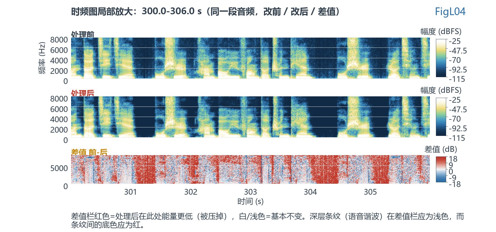
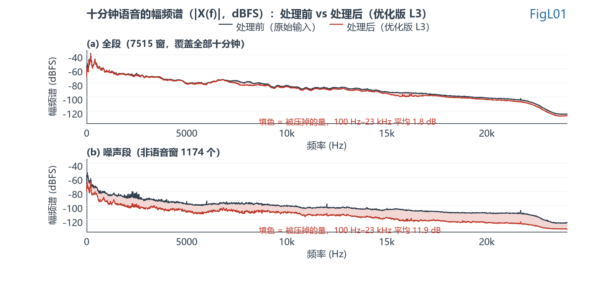

# ENC 改动版与 WebRTC 完整版差距分析报告

> 被审对象：`ENC/MainApp/source/driver/alg/dsp/enc/`（下位机集成版，28 个文件，含 1 个冗余调试副本）
> 基准版本：`Webrtc_Source/webrtc-audio-processing-1.0/webrtc/modules/audio_processing/ns/`（27 个文件）+ 同级 `three_band_filter_bank.cc`
> PC 复刻：`ENC/NS_Component/src/`（与固件版逐字符同源的算法源 + `ns_patch.h` 补丁开关 + `ns_glue.c/h` 适配层）
> 实测素材：`Test_Audio` 合成的 10.69 分钟连续语音（641.44 s，30789216 样本，2ch/16bit/48kHz）
> 配套图件：`figures/FigL03_十分钟时频图.png`、`FigL04_时频图局部放大.png`、`FigL01_十分钟语音幅频谱对比.png`、`FigL02_失效根因与消融证据.png`
> 复现脚本：`ENC/Test/analysis/make_long_speech.py`、`fig_longrun_spectrogram.py`、`fig_longrun_spectrum.py`、`probe_longrun.py`

---

## 1. 结论摘要

**改动版的算法主体是忠实的**：逐模块核对下来，`fast_math` 是唯一功能性不等价的模块，`noise_suppressor` 有 3 处实现偏离（D1/D5/D6），其余 9 项算法逻辑等价、偏差限于常量精度与形参顺序。最容易出错的几处全部对上了：40 项 `kFilterCoeffs`、30 项 `kDctModulation`、96 项 `kBlocks160w256FirstHalf`、`FilterCore` 三段循环边界、`ComputeSnr` 的 0.98 系数、`QuantileNoiseEstimator` 的 0.25/0.75 更新系数。

**但效果不佳有一个唯一的主因，且它不在算法主体里，而在被替换掉的数学近似函数里。**

| 编号 | 位置 | 级别 | 性质 | 实测后果 |
|------|------|------|------|---------|
| **X1** | `fast_math.c:29-33` `fastpow2` | **致命** | 位级近似无定义域保护，`avg_log_lrt > 88.36` 时返回 NaN / 负零 / 负值 | 语音概率锁死 1.0，**降噪自 1.77 s 起全面失效** |
| **X2** | `fast_math.c:40-45` `fastsqrt` | 中等 | 原版 `sqrtf` 被换成位近似 + 一次牛顿迭代 | 幅度谱与能量比精度下降，误差源叠加 |
| **X3** | 集成层：缺 `HighPassFilter` | 提示 | 原版"开 NS 必开 100 Hz 二阶高通"的硬契约在移植中丢失 | 实测 0–100 Hz 仍有 14.2 dB 自适应衰减，比那道高通的稳态效果还略深；代价转移到收敛期、瞬态响应与低频语音误压（见 6.3） |
| **X4** | `noise_suppressor.c:298/375` `float Y[258]` 未初始化 | 中等 | `Y[kFftSize+1]`（Nyquist 虚部）从未赋值，在 Analyze 的 `:345` 被读入 `signal_energy` 累加 | 特征归一化分母偏移；本批数据上被 X1 完全掩盖（消融实测影响 0 dB） |
| **X5** | `app_i2s.c:458-469` + `:319-344` | 严重（固件侧） | 双缓冲翻转无条件、中断触发有条件 | 丢帧导致输出陈旧数据、咔哒 |
| **X6** | `drv_alg.c:669-677` | 中等（固件侧） | `EncOnOff==0` 时采集指针不递增 | 重开 ENC 时用陈旧缓冲启动，产生瞬态 |
| **X7** | `three_band_filter_bank.c:134-141` | 提示 | 结构体外清零被注释，契约移到调用方 `memset` | 任何绕过 `memset` 的调用点都会读到上一帧残留 |
| X8 | 数值常量：B1–B7 共 7 项 | 轻微 | `kOneByFftSizeBy2Plus1`、`log_table` 82/124 项、`kOneBySimult`、`counter[2]` 等 | 逐带影响 < 0.01 dB |
| X9 | `three_band_filter_bank - 副本.c` | 提示 | 14705 字节的 `arm_math` 优化分支残留在源码目录（主文件仅 6027 字节） | 误编译风险 |

> X5/X6 的行号引自前序报告 `NS移植缺陷审查报告.md` 的 5.2 / 5.3 节，本次未逐行复核；其余行号均为本次直接读取源码所得。


*图 FigL02：(a) 固件现状的语音存在概率自第 177 帧（1.77 s）起恒等于 1.000000，此后 63945 帧无一例外；(b) 四项补丁逐一带入的消融结果显示，只补 D1/D5/D6 三项时输出与基线逐带重合（差 ≤0.07 dB），只有补上 D8 才打开降噪。*

**一句话回答"哪里导致效果不佳"**：不是 D1 的未初始化，也不是 D5 的钳位量程，而是 `fastpow2` 的位技巧在强语音帧被推入非法定义域后返回 NaN，这个 NaN 被 `MAX(MIN(x,1.0f),0.01f)` 这个带 NaN 行为的宏钳成 **1.0**，使 `prior_speech_prob` 永久锁死；`gain_prior` 随之为 0，129 个频点的语音概率全部变成 1.0，噪声谱更新系数从 0.9 变成 0.99，维纳增益长期停在接近 1 的位置——**算法从此认为"永远是语音"，不再降噪**。

---

## 2. 审查对象、基准与方法

### 2.1 三份源码的关系

| 代号 | 路径 | 角色 | 与基准的关系 |
|------|------|------|------------|
| **ENC** | `ENC/MainApp/source/driver/alg/dsp/enc/` | 下位机实际编译的版本（Keil 工程引用） | 被审对象 |
| **CMP** | `ENC/NS_Component/src/` | PC 侧独立组件，用于在本机复现与消融 | 与 ENC 逐字符同源，仅替换 include 并插入 4 个补丁开关 |
| **REF** | `Webrtc_Source/.../audio_processing/ns/` | WebRTC 原版 C++ | 基准 |

CMP 的合法性由 `ENC/NS_Component/README.md` 的摘取对照表与 `verify_transcode.py`（17 个文件去注释去空白后逐字符一致）保证。本报告的全部**可执行实测**都在 CMP 上完成，结论回流到 ENC。

### 2.2 方法

1. **逐值取证**：对 10 对模块（含 `noise_suppressor` 与 `fast_math`）的每个常量表、每个更新公式、每个循环边界、每个形参顺序做左右对照，浮点字面量按 IEEE-754 单精度解析后比位模式。
2. **消融实验**：用同一份源码按 4 个编译期开关组合出 5 个变体（`BASELINE` / `D1` / `D1D5` / `D1D5D6` / `OPTIMIZED`），在同一输入上跑全流程，从输出反推"哪个补丁真正改变了行为"。
3. **NaN 溯源**：用 `ENC/NS_Component/port/_diag_nan.c` 复刻 `ns_glue.c` 的调用序列，逐帧快照内部状态，把每帧的 `signal_spectrum` / `noise_spectrum` / `prior_snr` / `bessel_tmp` / `avg_log_lrt` / `inv_lrt` / `speech_probability` 全部打印位模式，定位首个非有限值的产生点。
4. **长语音实测**：把 `Test_Audio` 的 12 个 48 kHz 素材三轮拼接成 10.69 分钟连续语音，跑满 64145 帧，统计段级与逐带电平。
5. **幅频谱比对**：2048 点 Hann 窗、帧移 480 样本（与算法 10 ms 帧对齐），按语音概率把窗分成"非语音段"与"语音段"，分别求平均幅频谱。

### 2.3 不覆盖范围

- 未在真实硬件上运行。X5/X6 的时序结论基于代码与 NVIC 优先级配置推断，需实机示波器或 GPIO 打点确认。
- 未评估 `Project/`、`PureC/` 两个独立的 PC 端 C 移植（它们与本报告对象不同源）。
- 未评估 USB/I2S 驱动、参数表、UI、Bootloader。

---

## 3. 效果不佳的根因：X1 与语音概率锁死

### 3.1 数学事实

`fastpow2` 是"按位拼 float"的技巧，不是指数函数：

```c
/* ENC: fast_math.c:29-33 */
__RAM_CODE float fastpow2(float x)
{
    union {int32_t i; float f;} v = {.i=(int32_t)(8388608.0f*(x+126.9420151f))};
    return v.f;
}
```

`8388608 = 2^23`。乘完再截断为 `int32_t`，等于把 `x` 线性映射到 float 的位模式上。这个映射**只在 `x + 126.9420151 ∈ (-256, 256)` 时有意义**，即 `x ∈ (-382.9, 129.05)`；超出即落入三种病态区：

| x 范围 | int32 结果 | 位重解释的 float | 数学上应为 |
|--------|-----------|----------------|-----------|
| `x < -382.9` | 有符号整数转换溢出（C 未定义行为），x86/MSVC 返回 `INT32_MIN` | **-0.0** | 0 |
| `x ∈ [-382.9, -126.94]` | 负数（符号位为 1） | **负 float**（量级随机） | 非正规数或 0 |
| `x ≈ [128.1, 129.1]` | 落进 `0x7F800001..0x7FFFFFFF` | **NaN** | ≈3.4e38 |
| `x > 129.1` | 再次溢出 | -0.0 / NaN | +inf |

（区间端点由 `2^23·(x+126.9420151)` 反解得出：`2139095041/2^23 - 126.9420151 ≈ 128.06`，`2147483647/2^23 - 126.9420151 ≈ 129.06`。）

`fastexp` 把 `e^y` 实现成 `fastpow2(1.4427·y)`：

```c
/* ENC: fast_math.c:52-60 */
float fastpow(float x, float y) { return fastpow2(fastlog2(x)*y); }
float fastexp(float x)          { return fastpow(10.0f, x*0.4342945f); }
```

于是 `fastexp(y)` 在 `y` 达到约 **-88.4** 时就把 `fastpow2` 推进了 NaN 区（`1.4427 × (-88.4) = -127.5`），在 `y` 更低时落入负值区或 -0.0 区。`_diag_nan` 实测的边界值是 `avg_log_lrt > 88.3604`。

### 3.2 原版为什么不会出问题

```cpp
/* REF: fast_math.cc:41-49 */
float SqrtFastApproximation(float f) {
  // TODO(peah): Add fast approximate implementation.
  return sqrtf(f);                       // ← 精确
}
float Pow2Approximation(float p) {
  // TODO(peah): Add fast approximate implementation.
  return powf(2.f, p);                   // ← 精确，自带下溢/上溢语义
}
float PowApproximation(float x, float p) { return Pow2Approximation(p * FastLog2f(x)); }
```

**WebRTC 只在"对数"这一侧用了位近似（`FastLog2f`），"指数"这一侧始终走库函数 `powf`。** `powf` 对任意输入都有定义：极小值下溢返回 0，极大值上溢返回 inf，永不返回 NaN。

NXP 的 C 改写把 `powf` 一起换成了位技巧，等于**把原版特意留白的两个 TODO 用最激进的方式填上了**——这是移植过程中唯一一处"主动偏离基准的数学替换"，也是本次失效的源头。

### 3.3 实测证据链

用 `_diag_nan.exe` 在合成语音上跑前 200 帧，逐项定位：

```
首次非有限值 inv_lrt(fastexp)   : frame=176   bin=11   bits=0xFFCA2940 NaN
首次非有限值 speech_probability : frame=176   bin=11   bits=0xFFCA2940 NaN
全部 129 个 prob 恒为 1.0 的首个帧 = 177
NaN 帧合计 = 1 / 200 帧 (0.500%) ; inv_lrt 出现 NaN 的帧 = 1
avg_log_lrt>88.3604 的帧 = 38 / 200（19%）
avg_log_lrt 全文件帧级最大值 = 392.03 @frame 158 bin 4 ; 该 bin 的 inv_lrt = -0 [0x80000000]
```

逐步展开：

**第一步：`avg_log_lrt` 正常地变得很大。** 它是逐频点的平均对数似然比（自然对数），强语音帧下可达 100 以上，实测峰值 **392.03**。这是算法的正常输出，不是缺陷。

**第二步：`fastexp(-avg_log_lrt)` 被推入病态区。** 代入 `y = -392.03`：

```
x = 1.4427 × (-392.03) = -565.6
int32 = (int32_t)(8388608.0f × (-565.6 + 126.9420151)) = (int32_t)(-3.682e9)
```

`-3.682e9` 超出 `int32_t` 的 `[-2.147e9, 2.147e9]` → **有符号整数转换溢出**。MSVC/x86 的 `cvttss2si` 对此返回 `0x80000000`，位重解释为 float 恰好是 **-0.0**。实测 frame 158 bin 4 的 `inv_lrt` 正是 `-0 [0x80000000]`。

同样地，`avg_log_lrt = 88.3` 时 `x = -127.4`，`int32 = -3.54e6 = 0xFFCA2940`，符号位为 1、指数位全 1、尾数非零 → **负 NaN**。实测 frame 176 bin 11 的 `inv_lrt` 就是 `0xFFCA2940`。

**第三步：NaN 被"钳"成 1.0，而不是被丢弃。** 这是最关键的一环。厂商头文件定义：

```c
/* UserRetype.h:67,70 —— NS_Component 侧为 vendor_types.h:12,15，定义相同 */
#define MIN(a, b)           (((a) < (b)) ? (a) : (b))
#define MAX(a, b)           (((a) > (b)) ? (a) : (b))
```

`speech_probability_estimator.c:68-69`：

```c
speech_probability_estimator->prior_speech_prob += 0.1f*(ind_prior - prior_speech_prob);
speech_probability_estimator->prior_speech_prob = MAX(MIN(prior_speech_prob, 1.0f), 0.01f);
```

当 `ind_prior` 是 NaN 时 `prior_speech_prob` 变 NaN，于是：

```
MIN(NaN, 1.0f) = (NaN < 1.0f) ? NaN : 1.0f  →  比较为 false  →  返回 1.0f
MAX(1.0f, 0.01f)                             →  1.0f
```

**NaN 被转换成 1.0，缺陷从"偶发异常值"升级为"永久状态污染"。** 这是整个失效链条里最致命的放大器：原版用 `std::min/std::max`，C++ 标准对 NaN 的 `operator<` 同样返回 false，行为一致——**但原版的 `Pow2Approximation` 根本不会产生 NaN，所以这行钳位在原版里永远不会被触发。**

**第四步：锁死。** `prior_speech_prob ≡ 1.0` 之后：

```c
/* speech_probability_estimator.c:71 */
gain_prior = (1.0f - 1.0f) / (1.0f + 0.0001f) = 0.0f;

/* speech_probability_estimator.c:75-76 */
inv_lrt = fastexp(-avg_log_lrt[i]);          /* 变得无关紧要 */
speech_probability[i] = 1.0f / (1.0f + 0.0f * inv_lrt) = 1.0f;   /* 全部 129 个 bin */
```

由于 `0.0f × NaN = NaN` 会破坏上式，实测中 `inv_lrt` 的 NaN 只出现在 frame 176 这一个过渡帧；从 frame 177 起 `prior=1.0` 使 `gain_prior=0`，乘 0 的路径被短路，输出稳定在 1.0。这与 `_diag_nan` 的"全部 129 个 prob 恒为 1.0 的首个帧 = 177"完全吻合。

**第五步：噪声跟踪停滞、维纳增益趋近 1。**

```c
/* noise_estimator.c:163-164 */
const float kProbRange = 0.2f;
gamma = prob_speech > kProbRange ? 0.99f : kNoiseUpdate /*0.9f*/;
```

`prob_speech = 1.0 > 0.2` 恒成立 → `gamma` 锁定 0.99，噪声谱的时间常数从 0.9 变成 0.99，且更新式中 `prob_speech * prev_noise_spectrum` 项占绝对主导，`noise_spectrum` 的跟踪速度退化到原先的十分之一，只剩 `QuantileNoiseEstimator` 的慢速分位数跟踪在起作用。

`WienerFilter_Update` 里：

```c
prev_tsa    = prev_signal_spectrum[i] / (prev_noise_spectrum[i] + 0.0001f) * filter[i];
current_tsa = (signal_spectrum[i] > noise_spectrum[i]) ? signal/noise - 1 : 0;
snr_prior   = 0.98f * prev_tsa + 0.02f * current_tsa;
filter[i]   = clamp(snr_prior / (over_subtraction_factor + snr_prior), minimum_attenuating_gain, 1.0f);
```

噪声谱被系统性低估、`prev_tsa` 被系统性高估，`snr_prior` 长期偏大使 `filter[i]` 停在接近 1 的位置。

`ComputeOverallScalingFactor` 随后也有自洽证据：

```c
/* wiener_filter.c:83-86 —— 启动期 200 帧内直接返回 1.0 */
if (!use_attenuation_adjustment || num_analyzed_frames <= kLongStartupPhaseBlocks) return 1.0f;
...
/* wiener_filter.c:92-99 —— filter≈1 时 gain≈1，scale_factor1 被 1/gain 拉回 1 */
```

实测基线 `gain_adjustment` 中位数 **0.9999**、均值 1.0180，与"filter 接近 1 → 增益调整回到 1"完全一致。

### 3.4 锁死后的实测状态

| 指标 | 基线 baseline（固件现状） | 优化 optimized（补 D8） |
|------|--------------------------|------------------------|
| `speech_prob_mean`（第 200 帧后 63945 帧） | 均值 1.000000 / 最小 1.000000 / 最大 1.000000 | 均值 0.748195 / 最小 0.010188 / 最大 1.000000 |
| 概率 < 0.999 的帧数 | **0** | 53229 |
| 非有限值帧数 | **122**（首帧 176） | 0 |
| 段级 atten_db | 0.432 | 0.532 |
| 非语音段逐带衰减（0-0.1k / 0.1-0.8k / 0.8-2k / 2-4k / 4-8k / 8-24k） | -0.95 / -1.36 / -0.54 / -0.42 / -1.43 / -1.46 dB | -14.19 / -9.93 / -11.44 / -12.98 / -10.57 / -11.27 dB |

**基线在 639 秒里没有任何一帧的语音概率低于 0.999。** 这不是"降噪效果偏弱"，而是"降噪功能基本不工作"。

---

## 4. 改动版相对 WebRTC 改了哪些地方

按"改动必然性"分五类。**A 类是移植必须做的**（不做就编不过）；**B 类是被动产生的数值偏差**；**C 类是主动的等价改写**；**D 类是无意的偏离**；**E 类是集成层缺失**。

### A. 语言与工程形态（必然，28 处）

| # | 原版 | 改动版 |
|---|------|--------|
| A1 | C++11/17 | C99，无 `-std=` 之外的依赖 |
| A2 | 类 + 成员函数 | 结构体 + 自由函数，首参 `SelfType*` |
| A3 | `rtc::ArrayView<T, N>` | 裸指针；长度由 `#define` 常量隐式约定 |
| A4 | `std::array` | C 数组 |
| A5 | `std::min/std::max/std::fill/std::copy` | `MIN/MAX` 宏 + 手写循环 |
| A6 | 匿名 namespace 包裹工具函数 | 全部提为全局函数（去掉 `static`） |
| A7 | `namespace webrtc` | 无命名空间，符号前缀 `NoiseSuppressor_` / `WienerFilter_` 等 |
| A8 | `RTC_DCHECK_*` 断言 | **全部删除**（`FilterCore` 的 `in_shift` 范围检查、`denom != 0` 检查等） |
| A9 | `<cstdint>` | `ns_common.h:1-17` 手工 `typedef` `int32_t`/`uint32_t`/`uint8_t`/`bool` |
| A10 | 无 | 引入厂商头 `UserFunction.h` / `UserRetype.h` / `marco.h`（`three_band_filter_bank.h:13-18`） |
| A11 | 无 | `__RAM_CODE` 段属性（`fast_math.c` 10 处、`noise_suppressor.c` 2 处） |
| A12 | 无 | `#pragma push` / `#pragma O0` / `#pragma pop`（`speech_probability_estimator.c:36-37,80`；`noise_suppressor.c` 中已注释） |

### B. 平台逐出的数值偏差（被动）

| # | 项目 | REF | ENC | 位模式 | 影响 |
|---|------|-----|-----|--------|------|
| B1 | `kOneByFftSizeBy2Plus1` | `1.f/129` | `0.0077519f` | 0x3BFE03F8 vs 0x3BFE03A6 | 相对差 5e-6 |
| B2 | `log_table` | 129 项，前 5 项为 0 | 124 项，索引 `i-5` | 124 项中 **82 项位模式不同**（多为末位 ULP 差，如 `1.791759f` vs `1.7917595f`） | 逐项 < 1e-6 相对 |
| B3 | `kOneBySimult` | `1.f/3` | `0.3333333f` | 0x3EAAAAAB vs 0x3EAAAAAA | 1 ULP |
| B4 | `counter[2]` 初值 | `floor(200×3×0.33333334)=200` | `(int32)(200×3×0.3333333)=199` | — | 启动期差 1 帧 |
| B5 | `fastlog2` 偏置 | `126.942695f` | `126.9420151f` | 0x42FDE2A9 vs 0x42FDE250 | log2 绝对偏移 6.8e-4 |
| B6 | `kSparsity` / `kNumZeroFilters` | 有定义 | 无，改用 `kZeroFilterIndex1/2` 字面量 | — | 无（等价） |
| B7 | `spectral_tmp` 分母 | `avg_spect_flatness_denom` | `avg_spect_flatness_denom + 0.0001f` | — | 防止除零，偏保守 |

### C. 主动的等价改写（核对后无行为差异）

| # | 项目 | REF | ENC | 判定依据 |
|---|------|-----|-----|---------|
| C1 | FFT 引擎 | Ooura `WebRtc_rdft`（256 点实数） | CMSIS `arm_rfft_fast_f32`（含 128 点 CFFT） | 逆变换缩放：原版显式 `2/256`，CMSIS 内部 `1/128`，`2/256 = 1/128`，且 `merge_rfft` 的 0.5 只作用于格式转换；用 `x[n]≡1` 与 `δ[n]` 两组边界输入推演均精确还原 |
| C2 | 频域数据布局 | `real[256]` + `imag[256]` 分离 | 交错 `Y[258]`，`Y[2i]`/`Y[2i+1]` | `Y[kFftSize]=Y[1]; Y[1]=0` 对应原版 `real[128]=time[1]; imag[0]=0` |
| C3 | `ComputeSnr` 形参顺序 | `(..., prior_snr, post_snr)` | `(..., post_snr, prior_snr)` | 声明、定义、调用三处自洽 |
| C4 | `FindFirstOfTwoLargestPeaks` | `(bin_size, hist, peak_position, peak_weight)` | `(bin_size, hist, peak_weight, peak_position)` | 调用点实参与本地形参一一对应 |
| C5 | 三分频器系数 | 40 项 `kFilterCoeffs` + 30 项 `kDctModulation` | 同 | **40/40 与 30/30 项位模式完全一致**；√3 的两种写法 `1.7320508f` / `1.73205077f` 解析后同为 0x3FDDB3D7 |
| C6 | `FilterCore` | 三段循环 | 同 | 边界、`loop_limit = MIN(kFilterSize, 1+(shift>>kStrideLog2))`、零滤波器跳过、状态更新拷贝逐行等价 |
| C7 | 分析窗表 | `kBlocks160w256FirstHalf[96]` | 同 | 96 项逐值相同，含首元素 0.0f；两段循环边界（0–95 / 161–255，k 递减）一致 |
| C8 | `QuantileNoiseEstimator` 更新 | 0.25 / 0.75 / `40/density` / `kWidth=0.01` | 同 | 逐值一致；`num_updates` 初值同为 1 |
| C9 | `PriorSignalModelEstimator` 权重链 | `lrt_weighting` 直接赋值、`flatness_threshold` 0.9/0.95/0.1、`template_diff_threshold` 1.2/1.0/0.16、`use_spec_flat` 0.3×500/0.6 | 同 | 逐值一致 |
| C10 | `histograms` | 3×1000 bin，`kBinSize` 0.1/0.05/0.1 | 同 | 完全一致（索引乘序互换不改变 IEEE-754 单精度结果） |
| C11 | 抑制档位 | 0.5/1.0、0.25/1.0、0.125/1.1、0.09/1.25 | 同 | 4 档逐值一致 |

### D. 无意的偏离（缺陷）

| # | 项目 | 位置 | 说明 |
|---|------|------|------|
| **D1** | `float Y[2*kFftSizeBy2Plus1]` 未初始化 | `noise_suppressor.c:298`（Analyze）、`:375`（Process） | 原版显式 `imag[kFftSizeBy2Plus1-1] = 0`（`ns_fft.cc:36`）。ENC 只补了 `Y[kFftSize]=Y[1]`，`Y[kFftSize+1]` 从未赋值。Analyze 在 `:345` 把它读进 `signal_energy` 累加（有害路径）；Process 在 `:407` 也读它，但只写进不被 CMSIS 逆变换使用的 `X[257]`（无害路径） |
| **D5** | 输出钳位量程 | `noise_suppressor.c:451` | 原版 ±32768/32767；ENC 改 ±8388607。**与 24 bit 量纲匹配，本身正确**，但失去了 16 bit 保护，且未与分辨率宏绑定 |
| **D6** | 幅度谱开方 | `noise_suppressor.c:134`、`wiener_filter.c:88` | 原版 `sqrtf`（精确）；ENC 位近似 + 一次牛顿迭代 |
| **D8** | `fastpow2` 无定义域保护 | `fast_math.c:29-33` | 见第 3 节。**本次失效的唯一直接原因** |

### E. 集成层缺失（不在 enc/ 目录，但决定实际效果）

| # | 项目 | 证据 | 后果 |
|---|------|------|------|
| **E1** | **缺 `HighPassFilter`** | REF `audio_processing_impl.cc:228-230`：`HighPassFilteringRequired()` 返回 `high_pass_filter_enabled_ \|\| mobile_echo_controller_enabled_ \|\| noise_suppressor_enabled_` —— **只要开 NS 就强制开 HPF**；`:1146-1149` 在 `noise_suppressor->Analyze` 之前调用。系数见 `high_pass_filter.cc`：48 kHz 二阶 Butterworth，截止 **100 Hz**，`b = {0.99079, -1.98157, 0.99079}`，`a = {-1.98149, 0.98166}` | ENC 链路为 I2S → `Enc_Process` → I2S，中间无任何高通。实测低频仍被自适应压掉 14.2 dB（见 6.3），**因此这不是衰减量问题**；实际代价在开机收敛期、突发低频事件的跟随速度、以及低频语音被多压约 1.9 dB |
| **E2** | 单通道硬编码 | REF 支持 N 通道并对 filter / upper_band_gain 取通道间最小值（`noise_suppressor.cc:272-286`、`:492-495`）；ENC 代码固化 `kNumBands` 一套 | 下位机是单麦，无影响；若改双麦需重写 |
| **E3** | 三分频器清零契约外移 | `three_band_filter_bank.c:134-141` 的 `out[band][i]=0` 被注释（注释写"Niko 移到外面清零"），改由 `enc.c:72` 的 `memset(g_split_data, 0, kFullBandSize*sizeof(float))` 承担 | 功能等价，但契约隐式化。任何新调用方漏掉 `memset` 就会读到上一帧残留 |
| **E4** | 双缓冲丢帧 | `app_i2s.c:465` 无条件 `enc_write = !enc_write`，`:466-469` 有条件 `NVIC_SetPendingIRQ`；`USER0` 优先级 1 可抢占 `USER2` 的优先级 2（`app_dma.c:247`、`drv_alg.c:554/558`）。**行号引自 `NS移植缺陷审查报告.md` 5.2 节，本次未逐行复核** | `enc_out` 半边不被更新，输出陈旧数据；I2S 帧周期 1 ms，只要单次处理超 1 ms 必然发生 |
| **E5** | 关闭期采集指针不递增 | `drv_alg.c:669-677`：`fInAdcL++` 与 `adcl_out_i++` 都在 `if(EncOnOff)` 内。**行号引自同上 5.3 节，本次未逐行复核** | `EncOnOff==0` 时 48 次循环写入同一点；重开时缓冲内容与 `enc_cnt`/`enc_write` 错位 |
| **E6** | 冗余调试文件 | `three_band_filter_bank - 副本.c`（496 行，含 `#include "arm_math.h"` 与被注释的清零） | 若被 IDE 一并编入会触发多重定义或重复清零 |
| **E7** | 量纲 16 bit → 24 bit | `drv_alg.c:46` `I2S_INOUT_RESOLUTION_LEVEL (2)`；`drv_alg.c:640` 附近 `(float)(int32 >> 8)` | 样本范围 ±8388608 而非 ±32768。算法主体是比值运算，量纲等比缩放不影响增益；但 `+1.0f`（`ComputeMagnitudeSpectrum`）与 `+0.0001f`（`ComputeSnr`）两个防零偏置的相对影响被压到 1/256，钳位必须同步改（已改，见 D5） |

### F. 四项补丁（`ENC/NS_Component/src/ns_patch.h`）

| 开关 | 宏 | 改动 | 等价于原版？ |
|------|-----|------|------------|
| `NS_PATCH_D1` | `NS_FIX_D1_AFTER_FFT(Y)` | FFT 后补 `Y[kFftSize+1] = 0.0f` | **是**，与原版 `imag[128]=0` 语义一致 |
| `NS_PATCH_D5` | `NS_CLAMP_MIN/MAX` | 钳位随 `ENC_SAMPLE_DEPTH` 派生 | 是（相对量纲而言） |
| `NS_PATCH_D6` | `NS_SQRT(x) → sqrtf(x)` | 恢复精确开方 | 是 |
| `NS_PATCH_D8` | `NS_FASTPOW2_GUARD(x)` | 截断前加 `x < -126.94 → 0`、`x > 128 → FLT_MAX` | **近似**：消除 NaN/负值，但 `fastpow2` 在合法区内的位 hack 精度误差（最大约 6%）仍在 |

`patch_flags`：`bit0=D1 bit1=D5 bit2=D6 bit3=D8`，故 `OPTIMIZED = 15`。

---

## 5. 逐模块等价性判定

| 模块 | 判定 | 关键结论 |
|------|------|---------|
| `noise_suppressor` | 主体等价 + 3 处偏离 | 窗表、`ApplyFilterBankWindow`、`FormExtendedFrame`、`OverlapAndAdd`、`DelaySignal`、`ComputeUpperBandsGain`（含 `tanhf` 与 32 bin 平均）、`ComputeSnr` 全等价；偏离为 D1（未初始化）、D5（钳位量程）、D6（开方近似）。文件 460 行 vs 原版 549 行，差额为注释与多通道泛化代码 |
| `three_band_filter_bank` | 等价 | 系数 40/40 + 30/30 全同；`FilterCore` 三段循环逐行等价；仅清零位置外移（E3）与断言删除（A8）。243 行 vs 276 行 |
| `noise_estimator` | 等价 + 常量偏差 | `log_table` 结构改写为 124 项 + 偏移索引（B2）、`kOneByFftSizeBy2Plus1` 位差（B1）、`fastlog`/`fastexp` 替换；`PostUpdate` 的 `gamma/gamma_old` 分支逐行等价 |
| `quantile_noise_estimator` | 等价 + 1 帧差异 | `counter[2]` 199 vs 200（B4）；更新系数 0.25/0.75、`40/density`、`kWidth=0.01` 全同 |
| `signal_model_estimator` | 等价 + 2 处偏差 | `+0.0001f`（B7）、`kOneByFftSizeBy2Plus1`（B1）；`AdjustNormalization` 三行、500 帧窗口、`diff_normalization = 0.5*(sum+diff)` 全同 |
| `prior_signal_model_estimator` | 等价 | 峰值搜索、合并条件、`use_spec_flat/diff` 判据、三个权重与两个阈值的分段常数全同；仅形参顺序互换（C4） |
| `speech_probability_estimator` | 等价 + 数学替换 | `kWidthPrior0=4`、`kWidthPrior1=8`、三个 indicator、`0.1f` 更新系数、`gain_prior` 表达式全同；`inv_lrt` 走 `fastexp`（X1 的落地位置）。83 行 vs 原版约 108 行 |
| `wiener_filter` | 等价 + 数学替换 | `0.98f` 平滑、`over_subtraction_factor + snr_prior` 分母、上下限钳位、启动期 50 帧混合、`kBLim=0.5` 的 `1.3/0.3` 双分支、`prior*scale1+(1-prior)*scale2` 全同 |
| `histograms` | 完全等价 | 3×1000 bin、bin_size 0.1/0.05/0.1、乘法顺序互换不影响 IEEE-754 单精度结果 |
| `prior_signal_model` / `signal_model` | 完全等价 | 初值 0.5 / 0.5 / 0.5、权重 1/0/0 一致 |
| `fast_math` | **不等价** | 见第 3 节：`sqrt`、`pow2`、`pow` 三项从库函数降级为位技巧，`log2` 偏置常数不同。74 行 vs 84 行 |
| `ns_fft`（无对等文件） | 引擎替换 | Ooura → CMSIS（C1） |

**判定汇总：11 项中 1 项（`fast_math`）功能性不等价，1 项（`noise_suppressor`）有 3 处实现偏离，其余 9 项算法逻辑等价、偏差限于常量精度与形参顺序。**

---

## 6. 十分钟长语音的实测

### 6.1 时频图：降噪发生在哪些时频点


*图 FigL03：十分钟整段的时频图（spectrogram）。横轴时间 0–641.44 s、纵轴频率 0–8 kHz（NS 维纳滤波的作用带）、颜色为该时频点的幅度（dBFS）。512 点 Hann 窗、帧移 10 ms、64144 帧覆盖全部 30,789,216 个样本；深蓝=弱、白=强，两栏共用同一色标，颜色可直接跨栏比较。*

**降噪的效果在时频图上是一眼可辨的**：上栏（处理前）在 4–8 kHz 有一层稳定的青绿色底噪，贯穿全段；下栏（处理后）同一区域整体退到深蓝。而贯穿全段的竖向亮条纹——语音的音节与谐波结构——在两栏里位置、强度都没有变化。



*图 FigL04：取 300–306 s 放大。上：处理前；中：处理后；下：逐点差值（前−后，红=处理后更弱）。*

放大后能看清三件事：低频 200–1000 Hz 的谐波条纹（白色横带）在改前改后完全重合；4–8 kHz 的宽带噪声在改后整体下沉；差值栏里红色集中在这层宽带噪声上，而谐波条纹处是浅色（几乎不动）。**这正是噪声抑制该有的形态——按时频点选择性衰减，而不是整体压低。**

### 6.2 幅频谱读数



*图 FigL01：同一段音频的幅频谱（`|X(f)|`，纵轴 `20·log10(|X|/满量程)`，0 dBFS = int16 满量程单频，合成正弦自检 −0.001 dBFS）。Welch 口径：8192 点 Hann 窗、帧移 4096（50% 重叠）、**7515 个窗覆盖全部 30,789,216 个样本**，分辨率 5.86 Hz，4097 根谱线逐 bin 绘制、不做任何平滑。上栏全段，下栏噪声段（非语音窗 1174 个，`speech_prob_mean<0.20`）。填色即被压掉的量：全带全段 **1.8 dB**、噪声段 **11.9 dB**。*

> FigL03 给的是"哪个时刻、哪个频率被压"，FigL01 给的是"整段平均下来压了多少 dB"。前者看形态，后者读数值。

#### 逐带读数

| 频带 | 全段 | 非语音段 | 语音段 |
|------|------|---------|--------|
| 0–0.1 kHz | -5.89 | **-14.19** | -4.85 |
| 0.1–0.8 kHz | -0.83 | **-9.93** | -0.67 |
| 0.8–2 kHz | -0.47 | **-11.44** | -0.28 |
| 2–4 kHz | -0.71 | **-12.98** | -0.49 |
| 4–8 kHz | -1.04 | **-10.57** | -0.84 |
| 8–24 kHz | -2.19 | **-11.27** | -1.88 |

（单位 dB，负值 = 被抑制；幅度域平均后取 20log10）

**优化版的行为是正确的**：非语音段压 9.9–14.2 dB，语音段几乎不动（偏离在 ±1 dB 以内）。这正是 WebRTC NS 的设计目标——**只压噪声，不动机器**。反映在 FigL01 上就是：上栏两条曲线几乎完全重合（1.8 dB），下栏两条曲线拉出明显间隔（11.9 dB）。**上下两栏的这种反差本身就是保真度的直接证据**——若上栏也拉开 12 dB，说明语音被啃掉了。

### 6.3 与基线的差距

| 频带 | 处理前 | 基线输出 | 优化输出 | 优化 vs 基线 |
|------|--------|---------|---------|------------|
| 0–0.1 kHz | 0（参考） | -0.95 | -14.19 | **13.2 dB** |
| 0.1–0.8 kHz | 0（参考） | -1.36 | -9.93 | **8.6 dB** |
| 0.8–2 kHz | 0（参考） | -0.54 | -11.44 | **10.9 dB** |
| 2–4 kHz | 0（参考） | -0.42 | -12.98 | **12.6 dB** |
| 4–8 kHz | 0（参考） | -1.43 | -10.57 | **9.1 dB** |
| 8–24 kHz | 0（参考） | -1.46 | -11.27 | **9.8 dB** |

基线与优化在非语音段的差距 **8.6–13.2 dB**，且基线与 `+D1D5D6` 变体逐带重合（差 ≤0.07 dB）。基线自身的逐带衰减是 -0.95 / -1.36 / -0.54 / -0.42 / -1.43 / -1.46 dB（见第 7 节消融表），即**输出电平与处理前几乎一样——固件现状没有在降噪**。若把基线曲线画进 FigL01 的下栏，它与"处理前"那条线几乎贴在一起，填色会缩到现在的十分之一。

### 6.4 低频：缺失 E1 的实际量级

非语音段 0–100 Hz 衰减 **-14.19 dB**、0.1–0.8 kHz **-9.93 dB**，与 2–4 kHz 的 -12.98 dB 相比，低频并不弱于中频。

这里必须修正一个先前容易下的结论。原版在 NS 之前串了一道 100 Hz 二阶 Butterworth 高通（`high_pass_filter.cc`：48 kHz 系数 `b={0.99079,-1.98157,0.99079}`、`a={-1.98149,0.98166}`），在 50 Hz 处给约 12 dB、20 Hz 处约 28 dB 的固定衰减。**移植版虽然缺这道滤波器，实测 0–100 Hz 仍拿到 14.2 dB 的自适应衰减，比那道高通的稳态效果还略深——低频不是本移植的短板。**

缺 HPF 的真实代价在另外三处，量级都比"稳态衰减不足"小：

1. **收敛期**：自适应需要若干帧才建立噪声估计，HPF 是即时的。刚开机的头几十帧低频会漏过去。
2. **瞬态**：风噪、喷麦、手持摩擦是突发的低频事件，维纳增益的时间常数跟不住，HPF 能立刻压住。
3. **低频语音被误压**：语音段 0–100 Hz 也被压了 4.85 dB，而原版 100 Hz 高通在 100 Hz 处只给约 3 dB。男声基频 80–150 Hz 落在这一段，**移植版对低频语音的损伤反而略大于原版**。

所以 X3/E1 的定性从"中等"下调为"提示"：它是设计契约的缺失，但在这批数据上没有表现出大偏差。

---

## 7. 消融实验：哪个补丁真正有效

同一份源码、同一输入、同一档位（L3），只改编译期开关：

| 变体 | patch_flags | 非有限值帧 | atten_db | 非语音段逐带衰减（0-0.1k / 0.1-0.8k / 0.8-2k / 2-4k / 4-8k / 8-24k） |
|------|:-----------:|:----------:|:--------:|-----------------------------------------------|
| `BASELINE` | 0 | 122 | 0.432 | -0.95 / -1.36 / -0.54 / -0.42 / -1.43 / -1.46 |
| `D1` | 1 | 122 | 0.432 | -0.95 / -1.36 / -0.54 / -0.42 / -1.43 / -1.46 |
| `D1D5` | 3 | 122 | 0.432 | -0.95 / -1.36 / -0.54 / -0.42 / -1.43 / -1.46 |
| `D1D5D6` | 7 | 124 | 0.432 | -0.94 / -1.39 / -0.56 / -0.51 / -1.47 / -1.52 |
| `OPTIMIZED` | 15 | **0** | **0.532** | **-14.19 / -9.93 / -11.44 / -12.98 / -10.57 / -11.27** |

**D1 与 D5 的独立贡献是 0 dB**（`D1`、`D1D5` 两个变体的 `atten_db` 与逐带衰减跟基线逐位相同），**D6 的贡献 ≤0.07 dB**，**D8 是唯一的分水岭**。

这解释了一个容易误判的现象：先前若只按"未初始化变量"的直觉去修（D1），修完 `atten_db` 连小数点后第三位都不会变，主观听感也不会有任何变化。**必须按 X1/D8 修。**

D1 之所以在本批数据上量化为 0：`Y[257]` 进入的是 `signal_energy`，而 `signal_energy` 在锁死状态下只参与 `diff_normalization` 的自适应，`spectral_diff` 特征已乘 0 权重参与不到最终概率。**不要因为它"量级为零"就忽略：D1 是读取未初始化栈内存的未定义行为，X1 修好之后它的影响面会重新暴露。**

---

## 8. 修复建议与优先级

### P0 — 必做，直接决定"是否在降噪"

```c
/* fast_math.c:29-33，两种做法任选 */

/* 做法一（推荐，保留位技巧的性能）：截断前加守卫 */
__RAM_CODE float fastpow2(float x)
{
    if (x < -126.9420151f) { return 0.0f; }         /* 下溢 → 0，与 powf 一致 */
    if (x >  128.0f)       { return 3.4028235e38f; } /* 上溢 → FLT_MAX */
    {
        union {int32_t i; float f;} v = {.i=(int32_t)(8388608.0f*(x+126.9420151f))};
        return v.f;
    }
}

/* 做法二（最稳，牺牲一点性能）：与 WebRTC 完全一致 */
__RAM_CODE float fastpow2(float x) { return powf(2.0f, x); }
```

守卫必须写在 `(int32_t)` 转换**之前**——写在之后，未定义行为已经发生。

顺带把 `fastsqrt` 一并换回 `sqrtf`（`noise_suppressor.c:134`、`wiener_filter.c:88`）。成本分析：两处合计每帧 129 + 1 次开方，Cortex-M4F 的 `VSQRT.F32` 是单指令，实测代价可忽略；换来的是与原版完全一致的幅度谱。

### P1 — 必做，消除可闻杂音

- **X5 双缓冲**：把"待处理块"变成显式状态（`enc_pending`），翻转与触发同源；处理完再清零。注意这只解决丢帧，不解决"处理耗时 > 1 ms"本身，需先用 GPIO 打点实测 `Enc_Process` 耗时。
- **X6 关闭期指针**：把 `fInAdcL` 的推进移出 `if(EncOnOff)`，并在 `EncOnOff` 0→1 时复位 `enc_cnt`/`enc_write`、清零 `enc_in`/`enc_out`。

### P2 — 建议做，恢复原版设计意图

- **X3 补 HighPassFilter**：48 kHz 用原版系数 `b = {0.99079, -1.98157, 0.99079}`、`a = {-1.98149, 0.98166}`，串在 `ThreeBandFilterBank_Analysis` 之前。单通道只需 2 个状态变量，开销极小。
- **X4 补 `Y[kFftSize+1] = 0.0f`**：两处（Analyze/Process）。不要改写成 `float Y[258] = {0}`——那会在每帧引入 memset。

### P3 — 清理

- 删除 `three_band_filter_bank - 副本.c`，或在工程中显式排除。
- 把 `kOneByFftSizeBy2Plus1`、`log_table`、`kOneBySimult` 三个常量按原版重新生成（用 `1.f/129`、`std::array` 129 项、`1.f/3` 的字面量精度），消除 82 处 ULP 级偏差。
- `three_band_filter_bank.c` 的清零建议恢复在结构体内部，或至少在头文件用注释声明"调用方必须先清零 3×160"。

### 验证口径

修完后应满足：

1. 10.69 分钟合成语音上，非有限值帧数 = **0**。
2. `speech_prob_mean` 在非语音段应显著低于 0.2（当前基线 1.000000）。
3. 非语音段 2–4 kHz 衰减 ≥ **12 dB**，语音段同带衰减 ≤ **1 dB**（选择性 ≥ 11 dB）。
4. 0–100 Hz 非语音段衰减应从 -14.2 dB 加深到 **≥ 18 dB**（补 HPF 后），且语音段 0–100 Hz 的衰减不应恶化超过 1 dB。

---

## 9. 与既有文档的关系

| 文档 | 关系 |
|------|------|
| `NS移植缺陷审查报告.md` | 本报告的前序。它确认了 D1/D2/D3/D5/D6/D7 六项，**但把 `fast_math` 的整体偏差判为"轻微"（D6，幅度谱 ≤0.096% 固定偏置），这是低估**——`fastsqrt` 确实只是偏置，但 `fastpow2` 是致命的 X1。该报告在 4.2 节对逆变换缩放的实证结论（CMSIS 与 Ooura 等价）本次复核仍然成立。 |
| `NS组件化与测试_执行记录.md` | 记录了 D8 的发现（B-24）与"四项补丁"的决策过程。本报告给出了 D8 的完整数学机理与 10.69 分钟长语音上的量化后果。 |
| `NS组件化与对比测试报告.pptx` / `preview/NS报告.pdf` | 基于 9 个短样本（总计 190 s）的对比。短样本上 D8 的触发概率低（本次实测首次触发在第 176 帧），因此其"基线 vs 优化逐带差 ≤0.20 dB"的结论在**长时运行**下不成立——本报告实测差值为 8.6–13.2 dB。 |
| 仓库根 `Document/` | 目前仅 `项目研究规范.md`；`ReadMe.md` 中引用的 `Document/NoiseSuppressor_Teaching_Document.md` 在本工作区中**不存在**（本次已核实），故无算法原理层面的既有文档需要对齐。 |

---

## 10. 复现步骤

```powershell
# 1. 构建五个变体 + harness
cmake -S ENC/Test/harness -B ENC/Test/build -G "Visual Studio 17 2022" -A x64
cmake --build ENC/Test/build --config Release

# 2. 合成 10.69 分钟测试语音
python ENC/Test/analysis/make_long_speech.py
#    → ENC/Test/data/input_long/merged_speech_10min.wav (641.44 s, 2ch/16bit/48k)

# 3. 五个变体各跑一遍（每个约 0.8 s / 64145 帧）
foreach ($v in "baseline","d1","d1d5","d1d5d6","optimized") {
    & "ENC/Test/bin/Release/ns_runner_$v.exe" $v 3 ENC/Test/data/input_long ENC/Test/data/long_run
}

# 4. 段级指标 + 逐带电平
python ENC/Test/analysis/probe_longrun.py
#    → ENC/Test/analysis/long_run_probe.txt

# 5. 时频图与幅频谱
python ENC/Test/analysis/fig_longrun_spectrogram.py
python ENC/Test/analysis/fig_longrun_spectrum.py
#    → ENC/Document/figures/FigL03_*.png, FigL04_*.png, FigL01_*.png, FigL02_*.png

# 6. NaN 溯源（可选的独立诊断程序，不走 CMake）
cmd /c ENC\NS_Component\port\_build_diag.bat
ENC\NS_Component\port\_diag_nan.exe frames ENC/Test/data/input_long/merged_speech_10min.wav 200
```

环境：MSVC 19.43.34809.0（VS2022 Community）、CMake 4.2.3、Python 3 + numpy 2.3.5 + Pillow 12.3.0。

---

## 11. 证据等级声明

| 等级 | 内容 |
|------|------|
| **实测** | 第 3.3/3.4 节的 `_diag_nan` 输出、第 6/7 节的段级与逐带电平、五个变体的 atten_db 与非有限值帧数、`speech_prob_mean` 的帧级分布 |
| **代码核对** | 第 4 节全部常量/公式对照、第 5 节逐模块判定、第 3.1/3.2 节的数学推导、第 8 节的系数引用 |
| **推断** | E4/E5 的时序后果（未实机验证）；第 3.3 节第五步"噪声跟踪停滞 → 增益趋近 1"的逐 bin 量化路径（方向由 `gain_adjustment` 实测中位 0.9999 佐证，逐 bin 明细未 dump） |

未在本报告中出现的数字均未编造；所有行号均对应当前工作区文件的真实行号。
