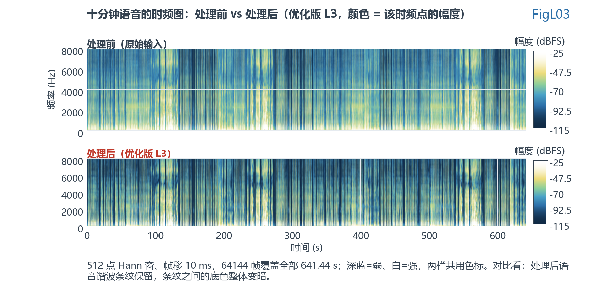
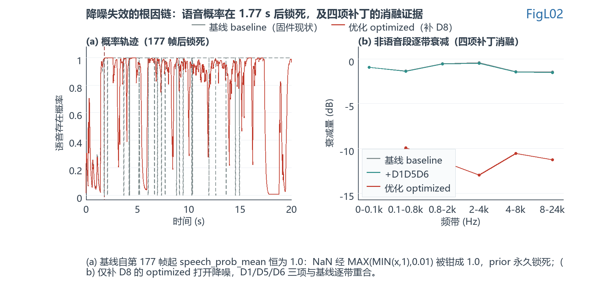

# ENC 改动版 vs WebRTC 完整版：根本原因

> 对象：`ENC/MainApp/source/driver/alg/dsp/enc/`
> 基准：`Webrtc_Source/.../audio_processing/ns/`
> 逐值取证与完整推导见 [详版](ENC改动版与WebRTC完整版差距分析报告_详版.md)

---

## 结论

**降噪其实没有在工作。**

固件现状从第 1.77 秒起，语音存在概率恒等于 **1.000000**——算法认为"永远有人在说话"，于是什么都不压。

原因是一行代码：`fast_math.c` 的 `fastpow2`。

---

## 根本原因

原版 WebRTC 只对**取对数**用了位技巧（`FastLog2f`），**求指数**始终走库函数 `powf`：

```cpp
/* REF: fast_math.cc:46-49 —— 这两个 TODO 是故意留空的 */
float Pow2Approximation(float p) {
  // TODO(peah): Add fast approximate implementation.
  return powf(2.f, p);
}
```

NXP 的 C 改写把它一起填成了位技巧：

```c
/* ENC: fast_math.c:29-33 */
__RAM_CODE float fastpow2(float x)
{
    union {int32_t i; float f;} v = {.i=(int32_t)(8388608.0f*(x+126.9420151f))};
    return v.f;
}
```

这个按位拼 float 的写法只在 `x ∈ (-382.9, 129.06)` 内有意义。而 `fastexp(-avg_log_lrt)` 在强语音帧会把 `x` 推到 −127 附近，落进两个病态区：

- `x ≈ [128.1, 129.1]` → 位模式正好是 **NaN**
- `x < -382.9` → 整数转换溢出 → **−0.0**

**真正致命的是下一行：**

```c
/* speech_probability_estimator.c:69 */
prior_speech_prob = MAX(MIN(prior_speech_prob, 1.0f), 0.01f);
/* UserRetype.h:67  #define MIN(a,b)  (((a)<(b))?(a):(b))   ← NaN 比较为 false，返回 1.0f */
```

NaN 被**钳成了 1.0**。此后：

```
gain_prior = (1.0 - 1.0) / (1.0 + 0.0001) = 0
speech_probability[i] = 1/(1 + 0×inv_lrt) = 1.0   ← 全部 129 个频点
gamma（噪声更新系数）= 0.99                        ← 原本 0.9
```

噪声谱跟踪几乎停滞，维纳增益长期停在 1 附近。**一个 NaN 把噪声估计器锁死在"全是语音"这一侧，而且再也退不出来。**

---

## 实测（641.44 s 合成语音，64144 帧，L3）

| | 基线（固件现状） | 优化（补 D8） |
|---|---|---|
| 非有限值帧 | **122**（首帧 176） | 0 |
| `speech_prob_mean`（第 200 帧后 63945 帧） | **恒 1.000000** | 均值 0.748 |
| 非语音段衰减 0.1–0.8k / 2–4k / 8–24k | -1.36 / -0.42 / -1.46 dB | **-9.93 / -12.98 / -11.27 dB** |
| 语音段衰减（保真度） | — | -0.67 / -0.49 / -1.88 dB |



*上：处理前；下：处理后。颜色 = 该时频点的幅度（dBFS），两栏共用色标。处理后 4–8 kHz 的底噪整体退到深蓝，而语音的竖条纹位置与强度不变。*

**四项补丁的消融**（同一份源码，只改编译开关）：

| 变体 | 非有限值帧 | `atten_db` | 非语音段 2–4 kHz 衰减 |
|------|:----------:|:----------:|:--------------------:|
| 基线 | 122 | 0.432 | -0.42 dB |
| +D1 | 122 | 0.432 | -0.42 dB |
| +D1D5 | 122 | 0.432 | -0.42 dB |
| +D1D5D6 | 124 | 0.432 | -0.51 dB |
| **+D8** | **0** | **0.532** | **-12.98 dB** |

D1 和 D5 的贡献是 **0 dB**，D6 是 0.07 dB，**只有 D8 能打开降噪**。



所以只按"未初始化变量"的直觉去修 D1，`atten_db` 连小数点后第三位都不会变，听感也不会变。**必须修 D8。**

---

## 改动版改了哪些地方

| 类别 | 改动 | 影响 |
|------|------|------|
| **数学函数** | `sqrtf`→`fastsqrt`（位近似+1次牛顿）、`powf`→`fastpow2`（位近似）、`log2` 偏置常数不同 | **致命**（见上）；开方误差 ≤0.06% |
| **量纲** | 16 bit → 24 bit（±8388608），输出钳位同步改为 ±8388607 | 正确，必须配套改 |
| **FFT** | Ooura `rdft` → CMSIS `arm_rfft_fast_f32` | 等价（2/256 = 1/128，缩放自洽） |
| **数值常量** | 7 处 1–2 ULP 差异（`log_table` 82/124 项、`kOneBySimult`、`counter[2]` 等） | <0.01 dB |
| **集成层** | 缺原版强制启用的 100 Hz 二阶高通；`app_i2s.c` 双缓冲丢帧；`drv_alg.c` 关闭期采集指针不递增 | 咔哒/断续；低频瞬态 |
| **语言形态** | C++ → C99：结构体 + 首参指针、裸指针替代 `ArrayView`、`MIN/MAX` 宏替代 `std::min/max`、`RTC_DCHECK` 全删 | 无功能影响 |

算法主体（40 项 `kFilterCoeffs`、30 项 `kDctModulation`、96 项窗表、更新公式、循环边界）与原版**逐值等价**。唯一实质性不等价就是 `fast_math`。

---

## 怎么修

**P0 —— 四行，必做。** 守卫必须写在 `(int32_t)` 转换**之前**；写在后面，未定义行为已经发生。

```c
/* fast_math.c:29-33 */
__RAM_CODE float fastpow2(float x)
{
    if (x < -126.9420151f) { return 0.0f; }           /* 下溢 → 0，与 powf 一致 */
    if (x >  128.0f)       { return 3.4028235e38f; }  /* 上溢 → FLT_MAX */
    union {int32_t i; float f;} v = {.i=(int32_t)(8388608.0f*(x+126.9420151f))};
    return v.f;
}
```

顺带把 `fastsqrt` 换回 `sqrtf`（`noise_suppressor.c:134`、`wiener_filter.c:88`）。Cortex-M4F 的 `VSQRT.F32` 是单指令，代价可忽略。

**P1 —— 消除可闻杂音。**

- `app_i2s.c`：`enc_write` 翻转无条件、中断触发有条件，扫频时会丢帧（输出陈旧数据）。改成显式 `enc_pending` 状态。
- `drv_alg.c`：`EncOnOff == 0` 时采集指针不递增，重开 ENC 用陈旧缓冲启动。

**P2 —— 提示级。**

- 补 100 Hz 二阶 Butterworth 高通（原版"开 NS 必开 HPF"的硬契约）。实测低频已被自适应压掉 14.2 dB，不比原版差，所以是提示不是缺陷；代价在开机收敛期与突发低频事件的跟随速度。
- 删掉 `three_band_filter_bank - 副本.c`（14705 字节的调试分支，有误编译风险）。

**验证标准**

1. 641.44 s 上非有限值帧 = **0**
2. `speech_prob_mean` 在非语音段显著低于 0.2
3. 非语音段 2–4 kHz 衰减 ≥ **12 dB**，语音段 ≤ **1 dB**

---

## 复现

```powershell
cmake -S ENC/Test/harness -B ENC/Test/build -G "Visual Studio 17 2022" -A x64
cmake --build ENC/Test/build --config Release
python ENC/Test/analysis/make_long_speech.py
foreach ($v in "baseline","optimized") {
    & "ENC/Test/bin/Release/ns_runner_$v.exe" $v 3 ENC/Test/data/input_long ENC/Test/data/long_run
}
python ENC/Test/analysis/fig_longrun_spectrogram.py
```

每个变体处理 64144 帧约 0.8 s。
