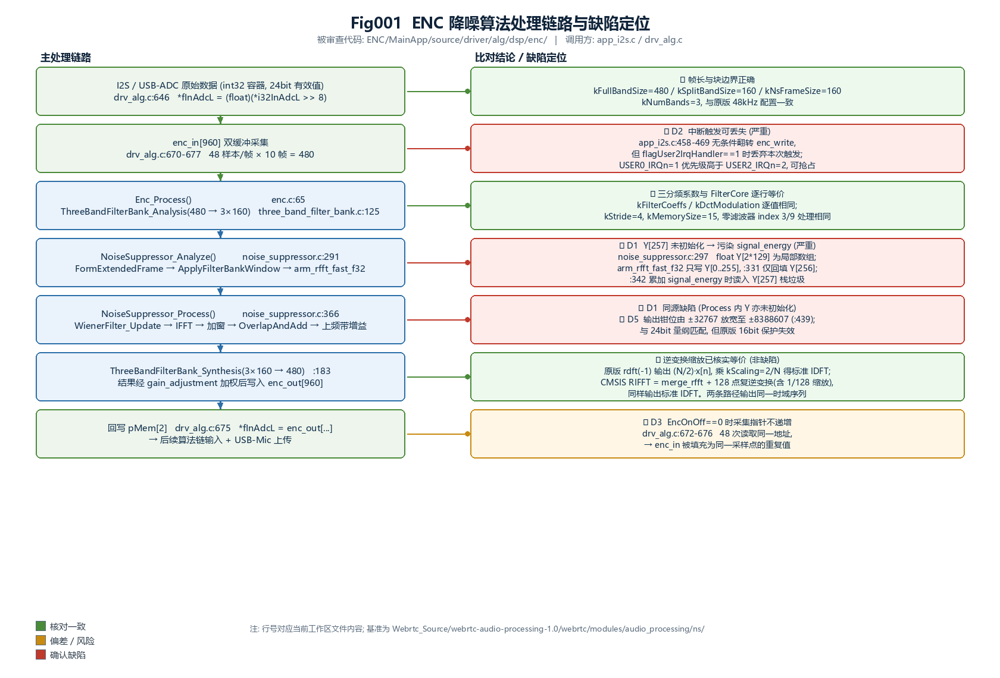
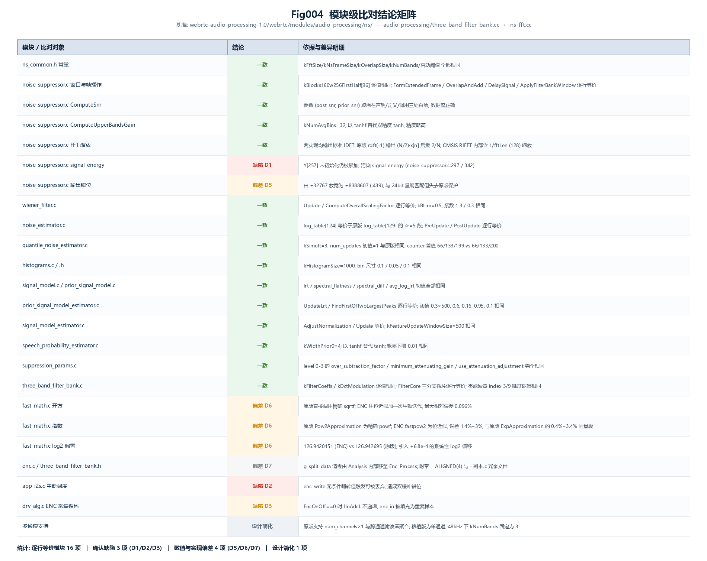
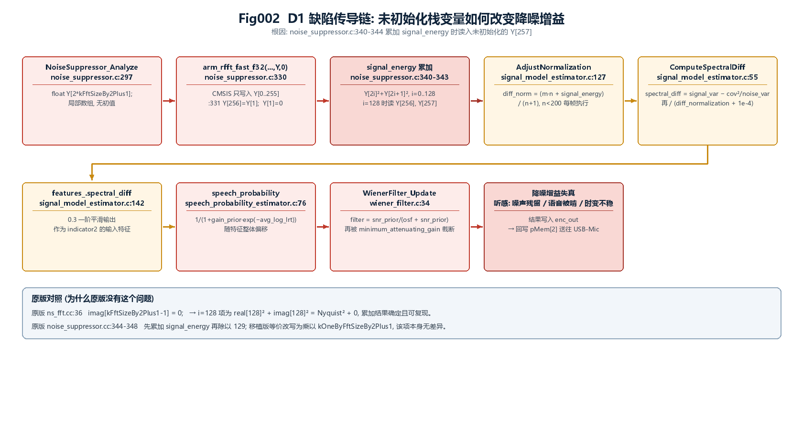
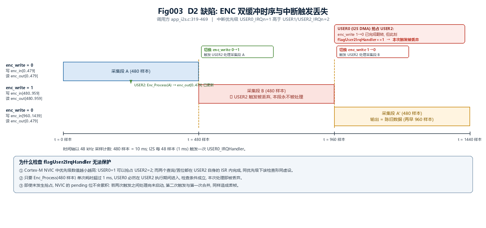
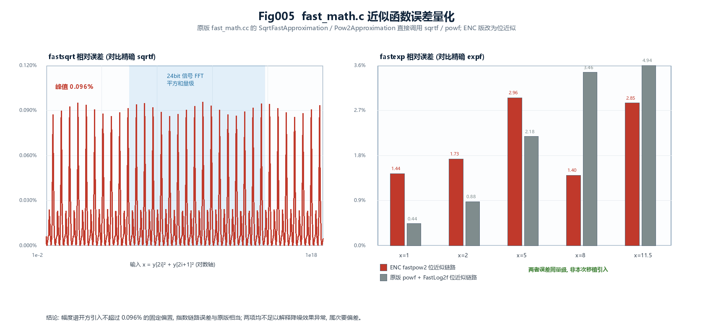

# ENC 降噪算法移植缺陷审查报告

> 审查对象：`ENC/MainApp/source/driver/alg/dsp/enc/`（嵌入式 C 版 WebRTC 噪声抑制器）
> 基准版本：`Webrtc_Source/webrtc-audio-processing-1.0/webrtc/modules/audio_processing/ns/`
> 报告日期：2026-07-28
> 配套图件：`figures/Fig001` ～ `figures/Fig005`
> 配套脚本：`scripts/gen_figures.py`、`scripts/ns_review_sim.py`

---

## 1. 审查范围与基准

### 1.1 范围

| 项目 | 内容 |
|------|------|
| 被审查代码 | `ENC/MainApp/source/driver/alg/dsp/enc/`（27 个 .c/.h）及调用方 `enc.c`、`app_i2s.c`、`drv_alg.c`、`main.c` |
| 算法基准 | `Webrtc_Source/webrtc-audio-processing-1.0/webrtc/modules/audio_processing/ns/` |
| 基准补充 | `.../audio_processing/three_band_filter_bank.cc`（三分频器）、`.../ns/ns_fft.cc`（FFT 封装） |
| 旁证实现 | `Project/ENC_Core/AudioProcess/`（同一仓库的 PC 端 C 移植，含自研 `fft_cal_transient.c` 与 Ooura `fft4g.c`） |
| 历史存档 | `ENC/MainApp/source/driver/alg/dsp/enc_20251230调通.zip`（调试期版本，用于确认缺陷引入时点） |

### 1.2 方法

1. **逐行等价性比对**：对全部算法模块做语句级对照，比对常量表逐值、循环边界、更新公式、初始化初值、参数顺序。
2. **第三方库行为实证**：`arm_rfft_fast_f32` 的缩放约定未在本仓库头文件中说明，故抓取 CMSIS-DSP 官方源码逐行核对，并以边界输入手工推演。
3. **数值误差量化**：用 Python 复现 `fast_math.c` 的位级近似，与精确数学函数对比（`scripts/ns_review_sim.py`）。
4. **调用链时序分析**：结合 `app_i2s.c` / `drv_alg.c` 的缓冲索引与 NVIC 优先级配置，还原数据流与中断竞争。

### 1.3 不覆盖范围

- 未在真实硬件上运行，所有硬件相关的时序结论均基于代码与寄存器配置推断，需实测确认。
- 未评估 DSH 宿主侧 `Project/`、`PureC/` 两个 C 移植的质量（`Document/archived/Bug分析报告.md` 已针对 `Project/ENC_Core` 出具过独立结论，与本报告对象不同）。
- 未评估 USB/I2S 驱动、参数表、UI 等其他模块。

---

## 2. 结论摘要

移植版的**算法主体是忠实的**：16 个模块与基准逐行等价，包含最容易出错的窗口系数表、`ComputeSnr` 参数顺序、`QuantileNoiseEstimator` 初值、`three_band_filter_bank` 的 `FilterCore` 三循环结构。**尤其需要澄清的是，逆变换缩放这一最可疑的点经实证是正确的**（见 4.2）。

缺陷集中在**算法层之外的三个位置**，其中两个属于严重级别：

| 编号 | 位置 | 级别 | 性质 | 影响 |
|------|------|------|------|------|
| **D1** | `noise_suppressor.c:297` / `:342`（及 `:370` Process 内同源） | **严重** | 未初始化栈内存被参与运算（未定义行为） | `signal_energy` 被污染 → 语音模型归一化与谱差特征偏移 → 维纳增益失真 |
| **D2** | `app_i2s.c:465-469` + `:319-344` | **严重** | 缓冲指针与处理触发不同步 | 丢帧导致输出陈旧数据（时序错位、咔哒/重复片段） |
| **D3** | `drv_alg.c:672-676` | 中等 | 指针递增条件分支不对称 | ENC 关闭期间 `enc_in` 被填充为重复样本，重开后出现瞬态 |
| D5 | `noise_suppressor.c:439` | 轻微 | 输出钳位量程由 16bit 放宽为 24bit | 与当前 24bit 量纲匹配，但失去原版保护 |
| D6 | `fast_math.c` 全体 | 轻微 | 近似函数精度低于原版 | 幅度谱 ≤0.096% 固定偏置，指数链路误差与原版同量级 |
| D7 | `enc.c:72`、`- 副本.c` | 提示 | 职责迁移与冗余文件 | 不影响运行，但增加误编译风险 |



*图 Fig001：ENC 固件版降噪处理链路（左侧）与本次比对结论（右侧）。绿色为核对一致项，橙色为偏差/风险，红色为确认缺陷。*

---

## 3. 处理链路与数据约定

理解缺陷需要先明确这套移植的数据约定，这些常量决定了"正确的量纲"是什么。

| 参数 | 值 | 来源 |
|------|-----|------|
| 采样率 / 帧长 | 48 kHz / 480 样本（10 ms） | `three_band_filter_bank.h:35` `kFullBandSize 480` |
| 子带数 | 3 | `ns_common.h:21` `kNumBands 3` |
| 子带帧长 | 160 样本 | `three_band_filter_bank.h:36` `kSplitBandSize 160` |
| FFT 点数 | 256（129 bin） | `ns_common.h:23-24` |
| 输入量纲 | **24 bit**，`(float)(int32 >> 8)`，范围 ±8388608 | `drv_alg.c:46` `I2S_INOUT_RESOLUTION_LEVEL (2)`；`drv_alg.c:646` |
| 采集/回写缓冲 | `enc_in[960]` / `enc_out[960]`，双缓冲 | `enc.c:30-31` |
| 中断分工 | USER0（I2S，每 48 样本）、USER1（ANS）、USER2（ENC） | `app_dma.c:247`、`drv_alg.c:554/558` |

处理调用序列（`enc.c:65-81`）：

```
memset(g_split_data, 0, 480 * sizeof(float));
ThreeBandFilterBank_Analysis(&enc->three_band_filter_bank, in, split_data);   // 480 → 3×160
NoiseSuppressor_Analyze(&enc->noise_estimator, split_data);                   // 统计与噪声谱
NoiseSuppressor_Process(&enc->noise_suppressor, split_data);                  // 滤波与合成
ThreeBandFilterBank_Synthesis(&enc->three_band_filter_bank, split_data, out); // 3×160 → 480
```

---

## 4. 算法层比对结论

### 4.1 逐模块明细

完整矩阵见 Fig004，此处仅摘录关键点。



*图 Fig004：24 个比对对象的逐项结论。16 项逐行等价，3 项确认缺陷，4 项数值/实现偏差，1 项设计简化。*

**核对一致且风险较高的项（已逐一验证，非缺陷）：**

- `kBlocks160w256FirstHalf[96]`（`noise_suppressor.c:18-38`）与原版 `noise_suppressor.cc:49-69` **逐值相同**，含首元素 0.0f。`ApplyFilterBankWindow` 的两段循环边界（0～95 与 161～255，k 由 95 递减）也与原版一致。
- `ComputeSnr` 的形参顺序被 NXP 调整为 `(post_snr, prior_snr)`，但**声明、定义、调用三处自洽**（`noise_suppressor.c:46`、`:138`、`:349`），数据流正确，不构成缺陷。
- `QuantileNoiseEstimator` 的 `num_updates` 初值为 **1**（`quantile_noise_estimator.c:38`），与原版 `quantile_noise_estimator.h:40` 的 `int num_updates_ = 1;` 相同——这一点容易误判为"初始化差异"，实际一致。
- `log_table[124]`（`noise_estimator.c:15-30`）是原版 `log_table[129]` 去掉前 5 个零元素后的平移副本，索引 `log_table[i-5]`（`:86`）与原版 `log_table[i]`（`noise_estimator.cc:73`）等价。
- `three_band_filter_bank.c` 的 `kFilterCoeffs`、`kDctModulation` 逐值相同；`FilterCore` 的三段循环、`loop_limit = MIN(kFilterSize, 1+(shift>>kStrideLog2))`、零滤波器 index 3/9 跳过逻辑、状态更新拷贝全部逐行等价。

### 4.2 逆变换缩放：本次审查最容易被误判的一点

**表面现象**：原版 `NsFft::Ifft`（`ns_fft.cc:54-61`）在 `WebRtc_rdft(kFftSize, -1, ...)` 之后显式乘了 `kScaling = 2.f / kFftSize`；而 ENC 版调用 `arm_rfft_fast_f32(&g_InstRfftF32, X, extended_frame, 1)`（`noise_suppressor.c:408`）后**没有任何缩放**。这看起来是缺失了 2/256 的增益。

**核实过程**：本仓库头文件（`ENC/MainApp/source/core/arm_math.h:2227`）只有声明，无缩放说明，因此抓取 CMSIS-DSP 官方源码核对。`arm_rfft_fast_f32` 的 `ifftFlag=1` 分支为：

```c
merge_rfft_f32(S, p, pOut);              /* 压缩格式 → 128 点复数 */
arm_cfft_f32(Sint, pOut, ifftFlag, 1);   /* 128 点复逆变换 */
```

而 `arm_cfft_f32` 非 MVE/NEON 分支（即 Cortex-M4 路径）末尾为：

```c
if (ifftFlag == 1U) {
    invL = 1.0f / (float32_t)L;          /* L = S->fftLen = 256/2 = 128 */
    /* Conjugate and scale output data */
    ...
}
```

**结论：两条路径都输出标准 IDFT 时域序列 `x[n]`，是等价的。**

- 原版：Ooura `rdft(-1)` 对 half-complex 输入输出 `(N/2)·x[n]`，乘 `2/N` 后归位为标准 IDFT。
- ENC：CMSIS `merge_rfft_f32` 完成"压缩格式→复数格式"的结构转换，`arm_cfft_f32` 内部完成 `1/128` 缩放，二者组合即为标准 IDFT。

以 `x[n] ≡ 1` 与 `x[n] = δ[n]` 两组边界输入手工推演 `merge_rfft` + 逆变换，输出均精确还原输入序列。

**必须注意**：不能用标量因子的乘积来比较——`merge_rfft` 内部的 `0.5` 因子作用于格式转换而非整体增益，`0.5 × 1/128 = 1/256` 与 `2/256` 不在同一层面。这类"看似少一个缩放"的判断需要走完整条数学路径才能定性。

> **旁证**：`Project/ENC_Core/AudioProcess/NoiseSuppressor.c:381-387` 有一行被注释掉的 `kScaling` 缩放，注释说明了"IFFT_table 内部已含缩放"。这与本次结论方向一致：使用自带归一化的 FFT 库时，外部不应重复缩放。

---

## 5. 确认缺陷

### 5.1 D1（严重）未初始化栈变量污染 signal_energy

**位置**：`noise_suppressor.c:297`（声明）、`:330-332`（FFT 及回填）、`:340-344`（累加）；`NoiseSuppressor_Process` 内 `:370`、`:387-389` 同源。

**代码事实**：

```c
297:  float Y[2*kFftSizeBy2Plus1];        /* 258 个 float, 局部数组, 未初始化 */
...
330:  arm_rfft_fast_f32(&g_InstRfftF32, extended_frame, Y, 0);  /* 仅写入 Y[0..255] */
331:  Y[kFftSize]=Y[1];                    /* 把 Nyquist 搬到 Y[256] */
332:  Y[1]=0.0f;
...
340:  for(i=0; i<kFftSizeBy2Plus1; i++)   /* i = 0..128 */
341:  {
342:      signal_energy+=Y[2*i]*Y[2*i]+Y[2*i+1]*Y[2*i+1];
343:      signal_spectral_sum+=signal_spectrum[i];
344:  }
```

`i=128` 时读取 `Y[256]`（已赋值，正确）与 **`Y[257]`（从未赋值）**。

**原版对照**：`ns_fft.cc:36` 明确写入 `imag[kFftSizeBy2Plus1 - 1] = 0;`，即 `imag[128] = 0`。原版 `noise_suppressor.cc:344-348` 的累加项 `real[128]² + imag[128]²` 是确定的。

**性质**：读取未初始化自动变量是未定义行为。在 Cortex-M 上该位置通常保留上一次同栈深度调用的残留值，因此表现为**持续的确定性偏差**而非随机噪声——这一点会影响症状的可复现性判断。

**影响传导链**（详见 Fig002）：



*图 Fig002：从栈变量到降噪增益的九级传导链。红色为缺陷链节，橙色为被污染的估计量，深红为可观测后果。*

`signal_energy` 的两个消费点：

1. `SignalModelEstimator_AdjustNormalization`（`signal_model_estimator.c:127-132`）——启动期（前 200 帧）每帧用 `signal_energy` 更新 `diff_normalization`：
   ```c
   diff_normalization *= num_analyzed_frames;
   diff_normalization += signal_energy;
   diff_normalization /= (num_analyzed_frames + 1);
   ```
2. `signal_model_estimator->signal_energy_sum += signal_energy`（`:144`），每 500 帧参与一次 `diff_normalization` 的长期更新（`:158-159`）。

`diff_normalization` 是 `ComputeSpectralDiff` 的归一化分母（`signal_model_estimator.c:86`），最终决定 `features_.spectral_diff`，也就是语音概率三个指示量之一 `indicator2` 的输入（`speech_probability_estimator.c:64-65`）。语音概率又直接进入维纳滤波器（`wiener_filter.c:34-56`）。

**为什么在 24bit 量纲下尤其值得怀疑**：当前配置输入为 ±8388608，256 点 FFT 的 DC 分量可达 2.1e9，平方和可达 4.6e18。该量级仍在 float 范围内（上限 3.4e38），因此 `Y[257]` 取到大值时**不会溢出为 inf**，而是被同量级地放大——症状表现为特征持续偏移，而不是崩溃。

**修复建议**（最小改动，保留编译期尺寸与性能）：

```c
/* noise_suppressor.c:297 与 :370 两处 */
float Y[2*kFftSizeBy2Plus1] = {0};
```

或在 FFT 之后显式补零，明确表达语义：

```c
330:  arm_rfft_fast_f32(&g_InstRfftF32, extended_frame, Y, 0);
331:  Y[kFftSize]     = Y[1];   /* Nyquist 实部 */
332:  Y[kFftSize + 1] = 0.0f;   /* Nyquist 虚部, 恒为 0 */
333:  Y[1]            = 0.0f;
```

推荐第二种：初始化整个 258 元素数组会引入 memset，而 `Process` 内该数组每帧都要重建；显式补零的成本更低且语义更清晰。

### 5.2 D2（严重）中断触发丢失导致双缓冲错位

**位置**：`app_i2s.c:465-469`（翻转与触发）、`:319-344`（USER2 处理）；优先级配置见 `app_dma.c:247` 与 `drv_alg.c:554/558`。

**代码事实**：

```c
458:  if (EncOnOff)
459:  {
460:      enc_cnt++;
461:      if(enc_cnt>=10)
462:      {
463:          enc_cnt = 0;
465:          enc_write = !enc_write;          /* 无条件翻转 */
466:          if (flagUser2IrqHandler == 0)
467:          {
468:              NVIC_SetPendingIRQ(USER2_IRQn);   /* 有条件触发 */
469:          }
```

```c
319:  __RAM_CODE void USER2_IRQHandler(void)
320:  {
321:      flagUser2IrqHandler = 1;
323:      if (EncOnOff)
324:      {
325:          if(enc_write == 1) { Enc_Process(&g_EncParam, enc_in,      enc_out);      }
333:          else               { Enc_Process(&g_EncParam, enc_in+480,  enc_out+480);  }
341:      }
343:      flagUser2IrqHandler = 0;
344:  }
```

**缺陷机理**：`enc_write` 决定后续 480 个样本写哪一半缓冲、读哪一半结果；但"处理哪一半"是在 USER2 中断里按当时的 `enc_write` 值决定的，且**翻转无条件、触发有条件**。二者一旦脱钩，`enc_out` 的对应半边就不会被更新。

**为什么检查 `flagUser2IrqHandler` 保护不了**：

- `USER0_IRQn` 优先级为 **1**（`app_dma.c:247`），`USER1/USER2_IRQn` 优先级为 **2**（`drv_alg.c:554/558`）。Cortex-M 中数值越小优先级越高，因此 **USER0 可以抢占 USER2**。
- `flagUser2IrqHandler` 的置位与清零都在 USER2 自身的 ISR 内完成。同优先级中断不能互相抢占，所以对同优先级的调用者而言这个标志恒为 0——它只在"被更高优先级抢占"时才有意义，而那正是本处发生的情形。
- I2S 帧周期为 48 样本 = **1 ms**。只要 `Enc_Process`（处理 480 样本）单次耗时超过 1 ms，USER0 必然在 USER2 执行期间进入，第 466 行的判断成立，该次处理被丢弃。

时序关系见 Fig003：



*图 Fig003：三段采集的时间关系。橙色竖线为 `enc_write` 翻转点，红色框为 USER0 抢占导致的触发丢弃，第三段泳道显示由此读到的陈旧输出。*

**补充风险**：即使不发生抢占，NVIC 的 pending 位不累积。若两次触发间隔内上一次处理尚未启动，第二次 `NVIC_SetPendingIRQ` 与第一次合并，同样丢帧。

**修复建议**：把"待处理块"作为显式状态，而不是靠指针翻转隐式表达。

```c
/* 全局新增 */
static volatile uint8_t enc_pending = 0;   /* 0=无, 1=前半待处理, 2=后半待处理 */

/* app_i2s.c:458-469 改为 */
if (EncOnOff)
{
    enc_cnt++;
    if (enc_cnt >= 10)
    {
        enc_cnt = 0;
        enc_write = !enc_write;
        enc_pending = enc_write ? 1 : 2;   /* 记录哪一半待处理, 不丢弃 */
        if (flagUser2IrqHandler == 0)
        {
            NVIC_SetPendingIRQ(USER2_IRQn);
        }
    }
}

/* USER2_IRQHandler 改为按 enc_pending 决定, 处理完再清零 */
__RAM_CODE void USER2_IRQHandler(void)
{
    flagUser2IrqHandler = 1;
    if (EncOnOff && enc_pending != 0)
    {
        if (enc_pending == 1) { Enc_Process(&g_EncParam, enc_in,     enc_out);     }
        else                  { Enc_Process(&g_EncParam, enc_in+480, enc_out+480); }
        enc_pending = 0;
    }
    flagUser2IrqHandler = 0;
}
```

注意：该改动只解决"触发丢失"，**不解决"处理耗时超过 1 ms"本身**。若实测 `Enc_Process` 确实超时，需要考虑降低帧处理频率（如每 20 ms 处理一次 960 样本）、把算法搬进 DSP，或允许丢帧但同步推进读指针（即接受处理延迟但保证时序一致）。

**必须先实测 `Enc_Process` 耗时**再决定修复策略——`enc.c:19` 的 `ENC_GPIO_PROFILE_EN` 就是为此预留的打点开关，但注释说明 GPIO0.28 已改作 RGB 灯数据线而无法共用，需另选引脚。

### 5.3 D3（中等）ENC 关闭期间采集指针不递增

**位置**：`drv_alg.c:669-677`。

```c
669:  fInAdcL = (float *)(pMem[2]);
670:  for(uint8_t i = 0; i<48; i++)
671:  {
672:      enc_in[adcl_in_i++] = *fInAdcL;
673:      if (EncOnOff)
674:      {
675:          *fInAdcL++ =  enc_out[adcl_out_i++];
676:      }
677:  }
```

`fInAdcL` 与 `adcl_out_i` 的递增都在 `if (EncOnOff)` 分支内。当 `EncOnOff == 0` 时：

- `fInAdcL` 不前进，48 次循环写入的是**同一个采样点**的重复值；
- `adcl_out_i` 也不前进，索引自身一致（这一点是对的）。

当前默认 `bool EncOnOff = 1;`（`drv_alg.c:578`），因此暂不暴露。但一旦通过按键关闭再开启 ENC，`enc_in` 的内容与 `enc_cnt`/`enc_write` 的时序已经错位，重开后最初若干个处理块会输出瞬态。

**修复建议**：

```c
for(uint8_t i = 0; i<48; i++)
{
    float adc_sample = *fInAdcL;
    enc_in[adcl_in_i + i] = adc_sample;
    if (EncOnOff)
    {
        fInAdcL[i] = enc_out[adcl_out_i + i];
    }
}
fInAdcL += 48;
```

同时建议在 `EncOnOff` 由 0 变 1 时复位 `enc_cnt`、`enc_write` 并清零 `enc_in`/`enc_out`，避免用陈旧缓冲启动。

---

## 6. 次要偏差

### 6.1 D5 输出钳位量程

`noise_suppressor.c:438-439`：

```c
//  split_data[band][i]=MIN(MAX(split_data[band][i], -32768.0f), 32767.0f);//16bit
    split_data[band][i]=MIN(MAX(split_data[band][i], -8388607.0f), 8388607.0f);//24bit
```

原版为 ±32768/32767（`noise_suppressor.cc:543`）。当前输入量纲为 24 bit（`I2S_INOUT_RESOLUTION_LEVEL == 2`），因此 **24bit 钳位是与数据约定匹配的正确选择**，不构成错误。

需要留意的是：这行改动同时移除了原版的 16bit 保护。若日后把 `I2S_INOUT_RESOLUTION_LEVEL` 改回 1（`>> 16`，16bit 量纲），钳位就失去意义。建议把它与分辨率宏绑定：

```c
#if (I2S_INOUT_RESOLUTION_LEVEL == 1)
    #define ENC_SAMPLE_MAX   32767.0f
    #define ENC_SAMPLE_MIN  -32768.0f
#else
    #define ENC_SAMPLE_MAX   8388607.0f
    #define ENC_SAMPLE_MIN  -8388608.0f
#endif
```

另外，钳位是"最后防线"而非设计手段。若合成链路增益严格为 1，输出不会触及边界；一旦触发钳位，说明前级已有异常增益，此时应排查而不是放宽上限。

### 6.2 D6 数学近似精度

`fast_math.c` 用位近似替代了原版的精确调用：

| 函数 | 原版实现 | ENC 实现 | 实测最大相对误差 |
|------|---------|---------|-----------------|
| `SqrtFastApproximation` | `sqrtf(f)` 精确 | `fastsqrt`：位近似 + 一次牛顿迭代 | **0.096%** |
| `Pow2Approximation` | `powf(2.f, p)` 精确 | `fastpow2`：纯位近似 | **2.9%** |
| `LogApproximation` | `FastLog2f × ln2` | `fastlog2 × 0.6931472f` | 常数偏置差 6.8e-4 |

`fastexp` 链路的实际误差对比（`scripts/ns_review_sim.py` 输出）：

| x | `expf` 基准 | ENC `fastexp` | ENC 误差 | 原版 `ExpApproximation` | 原版误差 |
|---|------------|---------------|---------|------------------------|---------|
| 1.0 | 2.718282e+00 | 2.757310e+00 | 1.44% | 2.706343e+00 | 0.44% |
| 5.0 | 1.484132e+02 | 1.440274e+02 | 2.96% | 1.451824e+02 | 2.18% |
| 8.0 | 2.980958e+03 | 2.939154e+03 | 1.40% | 2.877811e+03 | 3.46% |
| 11.5 | 9.871577e+04 | 9.590364e+04 | 2.85% | 9.384303e+04 | 4.94% |



*图 Fig005：左为 `fastsqrt` 相对误差曲线（青色区间为 24bit 信号的 FFT 平方和量级），右为 `fastexp` 两条实现路径的误差对比。*

**判读**：原版 `SqrtFastApproximation` 是精确的，ENC 引入的 0.096% 是其唯一真实的精度损失，作用于幅度谱，属可忽略量级。而指数链路两者的误差同量级（原版因 `FastLog2f` 的位近似反而在某些点更大），**不属于本次移植引入的缺陷**。

结论：D6 不足以解释降噪效果异常，可保留现状；若后续追求数值一致性，把 `fastsqrt` 换回 `sqrtf` 是低成本选项（代价是每帧 128 次开方的周期开销）。

### 6.3 D7 实现细节

- **清零职责迁移**：`ThreeBandFilterBank_Analysis` 内的输出清零被注释掉（`three_band_filter_bank.c:134-141`），改由 `Enc_Process` 统一 `memset`（`enc.c:72`）。当前调用方唯一，逻辑正确；但该函数已成为"必须由外部清零"的隐式契约，建议在头文件注释中写明。
- **冗余文件**：`three_band_filter_bank - 副本.c`（496 行，含 `#if 0` 的优化分支）与正本并存。文件名含空格与中文，若被误加入 Keil 工程会因重复符号而链接失败。建议移出源码目录。
- **无用声明**：`noise_suppressor.c:303` 与 `:376` 各声明了一个未使用的 `arm_rfft_fast_instance_f32 InstRfftF32;` 局部变量，白白占用栈空间。
- **零上下文缺口**：`ns_common.h` 的 `kOneByFftSizeBy2Plus1 = 0.0077519f` 与精确值 `1/129 = 0.0077519380` 相差 4.9e-6（可忽略），但该常量在原版是就地计算的，移植后成为手写字面量，建议直接写 `(1.0f/129.0f)` 以免日后误改。

---

## 7. 根因分析

### 7.1 为什么症状表现为"效果似乎有点问题"而不是彻底失效

D1 与 D2 的共同特征是**不产生崩溃、不产生静音、不产生明显爆音**，而是让算法在"正确的框架里给出偏差的数值"：

| 缺陷 | 症状特征 |
|------|---------|
| D1 | 噪声抑制量不稳定、语音段被过度衰减或噪声段残留，启动期（前 2 秒）尤甚；同一段音频重复处理结果一致（栈残留值稳定） |
| D2 | 间歇性时序错位，表现为咔哒、片段重复或局部"没降噪"，出现频率随处理器负载变化 |

这恰好符合"算法本身看起来是对的、但听感不对"的描述。

### 7.2 定位优先级

`scripts/ns_review_sim.py` 与逐模块比对已经**排除**了以下常见怀疑方向：

- ~~窗口系数表抄错~~ → `kBlocks160w256FirstHalf` 逐值相同
- ~~`ComputeSnr` 参数顺序错乱~~ → 三处自洽
- ~~IFFT 缺少 2/N 缩放~~ → 两条路径都输出标准 IDFT
- ~~采样率/帧长常量错配~~ → 480/160/256/3 全部一致
- ~~`QuantileNoiseEstimator` 初值差异~~ → `num_updates = 1` 与原版相同
- ~~降噪等级参数错~~ → level 0-3 的四个参数完全相同

剩余的 D1 与 D2 是当前证据链下最可能的两个根因，且二者互不排斥，可能叠加。

---

## 8. 复现与验证方案

以下步骤用于把本报告的推断转成实测结论。所有改动均在临时分支或调试构建中进行。

### 8.1 验证 D1

在 `NoiseSuppressor_Analyze` 的累加循环后加临时断言或串口打印：

```c
/* noise_suppressor.c, 紧接 :344 之后 */
#if (ENC_DEBUG_ENERGY)
    printf("Y257=%e  signal_energy=%e\r\n", Y[kFftSize + 1], signal_energy);
#endif
```

判读标准：

- 若 `Y257` 恒为 0 或极小值 → D1 实际影响有限，需转向 D2。
- 若 `Y257` 为 `1e6` 以上量级且每帧稳定 → D1 成立，`signal_energy` 相对真实能量被显著抬高。
- 对比修复前后同一段音频的 `signal_energy`、`diff_normalization`、`features_.spectral_diff` 三条曲线，确认传导链是否如 Fig002 预测。

### 8.2 验证 D2

1. 恢复 `enc.c:19` 的 `ENC_GPIO_PROFILE_EN` 打点，把 GPIO 换到不与 WS2812 冲突的引脚（`enc.c:16-18` 注释已说明冲突原因），用示波器测量 `Enc_Process` 单次执行时间。
2. 判读：若耗时 > 1 ms → D2 成立；若 << 1 ms，则抢占路径不触发，但 NVIC pending 合并路径仍需通过统计验证。
3. 统计验证：在 `USER2_IRQHandler` 中累加一个 `enc_proc_count`，在 `app_i2s.c:463` 累加一个 `enc_switch_count`，运行 60 秒后比较二者。**`enc_switch_count` 应始终等于 `enc_proc_count`**，若前者偏大即为丢帧。

### 8.3 验证 D3

把 `EncOnOff` 通过按键置 0，运行 5 秒后置 1，用 USB-Mic 抓取重开瞬间的输出，检查是否存在瞬态；同时打印 `enc_in[0]` 与 `enc_in[47]`，关闭期间二者应相等（当前实现的必然结果）。

### 8.4 回归验证

修复后需要确认的指标：

- 纯噪声段（无语音）的能量衰减量应接近所选等级的标称值（level 3 为 20.9 dB 上限，见 `suppression_params.c:40-44`）。
- 启动期（前 200 帧 = 2 秒）不应出现增益跳变。
- 连续运行 10 分钟无丢帧计数偏差。

---

## 9. 未验证项与限制

| 项 | 说明 |
|----|------|
| `Enc_Process` 实际耗时 | 未在硬件上测量，D2 的触发概率基于 1 ms 帧周期的推断。这是本报告最大的不确定点。 |
| `Y[257]` 的实际栈残留值 | 取决于 ARMCC 的栈布局与调用深度，未实测。D1 的影响幅度因此是一个区间而非确定值。 |
| 栈深度是否足够 | `NoiseSuppressor_Analyze` 局部数组约 3.6 KB，`NoiseSuppressor_Process` 约 3.2 KB，且运行在中断上下文。若中断栈小于该量级会出现更严重的破坏，需要核对启动文件与链接脚本的栈配置。 |
| 24bit 量纲对算法的影响 | 原版按 floatS16（±32768）设计。当前 ±8388608 的量纲使 `ComputeMagnitudeSpectrum` 中的 `+1.0f` 保护完全失效（数值上远小于有效位），`QuantileNoiseEstimator` 的 `log_quantile` 初值 8.0 也偏离真实噪声水平。这两点对绝对量级是自适应的，但需要实测确认收敛时间是否可接受。 |
| `arm_rfft_fast_f32` 版本差异 | 核实依据为 CMSIS-DSP 主干源码。本工程使用 `arm_cortexM4lf_math.lib`（12 MB，版本未标注），若为旧版实现需复核 `arm_cfft_f32` 的缩放分支。**建议用第 8.1 节的打印方式顺带验证 FFT→IFFT 的往返增益**。 |

---

## 10. 关联文件

### 被审查文件（`ENC/MainApp/source/driver/alg/dsp/enc/`）

```
enc.c / enc.h                        主封装与全局缓冲
noise_suppressor.c / .h              D1 缺陷位置；核心分析与处理
fast_math.c / .h                     D6；位近似数学函数
noise_estimator.c / .h               噪声谱估计
quantile_noise_estimator.c / .h      分位数噪声估计
signal_model.c / .h                  信号模型
signal_model_estimator.c / .h        D1 传导链关键节点
prior_signal_model.c / .h            先验信号模型
prior_signal_model_estimator.c / .h  先验模型更新
speech_probability_estimator.c / .h  语音概率
histograms.c / .h                    特征直方图
wiener_filter.c / .h                 维纳滤波器
suppression_params.c / .h            降噪等级参数
three_band_filter_bank.c / .h        三分频器
ns_common.h                          全局常量
three_band_filter_bank - 副本.c      D7；冗余调试分支
```

### 调用方

```
ENC/MainApp/source/app/app_i2s.c         D2 缺陷位置；USER2 处理与缓冲翻转
ENC/MainApp/source/driver/alg/dsp/drv_alg.c   D3 缺陷位置；采集与回写
ENC/MainApp/source/app/app_dma.c         USER0 优先级配置
```

### 基准与旁证

```
Webrtc_Source/webrtc-audio-processing-1.0/webrtc/modules/audio_processing/ns/   算法基准
Webrtc_Source/.../audio_processing/three_band_filter_bank.cc                    三分频基准
Webrtc_Source/.../ns/ns_fft.cc                                                  逆变换缩放基准
Project/ENC_Core/AudioProcess/                                                   仓库内 PC 端 C 移植
ENC/MainApp/source/core/arm_math.h                                               CMSIS 声明（无缩放说明）
```

### 本报告产物

```
Document/NS移植缺陷审查报告.md         本报告
Document/figures/Fig001..005           图件
Document/scripts/gen_figures.py        图件生成脚本（Pillow）
Document/scripts/ns_review_sim.py      数值验证脚本
Document/scripts/ns_review_sim_output.txt  数值验证原始输出
```

复现命令：

```pwsh
cd ENC/Document/scripts
python gen_figures.py       # 生成 figures/ 下全部图件
python ns_review_sim.py     # 生成数值验证文本输出
```
