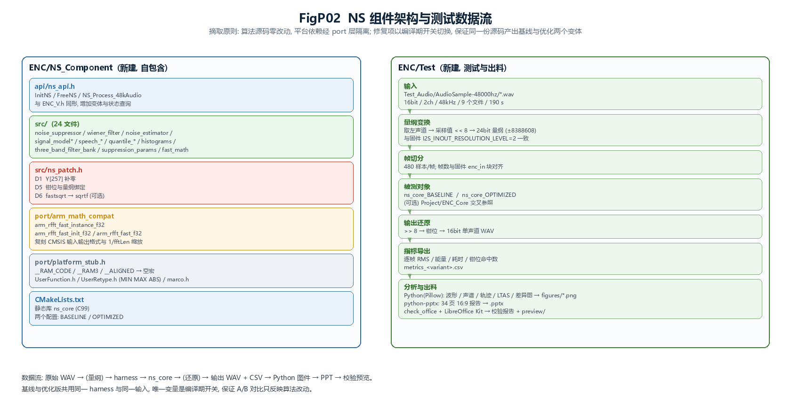
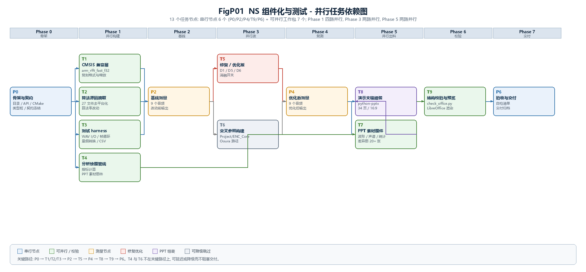

# NS 算法组件化与对比测试 — 开发计划

> 目标仓库：`D:\workshop\Github\EmbeddedNS-Portable`
> 计划对象：`ENC/MainApp/source/driver/alg/dsp/enc/`（NXP/CMSIS 版噪声抑制移植）
> 测试数据：`Test_Audio/AudioSample-48000hz/`（9 个 WAV，16 bit / 2 ch / 48 kHz，共 190.42 s）
> 前置报告：`ENC/Document/NS移植缺陷审查报告.md`
> 状态：**已冻结**（6 项决策点已于 2026-07-28 全部关闭，见第 4 节）

---

## 1. 目标与交付物

### 1.1 目标

把 `ENC/` 下那份依附于 JAT1821 固件工程、依赖 CMSIS 与厂商头文件的降噪算法，**摘成独立、可在 PC 上编译与调用的算法组件**；用它跑通 `Test_Audio/AudioSample-48000hz` 全量数据，产出**改动前**与**优化后**两套可比对的测试结果，并交付一份**图文并茂的 PowerPoint 测试报告**（34 页、20+ 张图、原生图表与表格）。

### 1.2 交付物

| 编号 | 交付物 | 位置 |
|------|--------|------|
| D1 | 独立算法组件（源码 + 平台适配层 + CMake） | `ENC/NS_Component/` |
| D2 | 构件产物：基线库、优化库、测试驱动 | `ENC/NS_Component/build/`、`ENC/Test/bin/` |
| D3 | 基线输出音频与指标 CSV | `ENC/Test/data/baseline/` |
| D4 | 优化后输出音频与指标 CSV | `ENC/Test/data/optimized/` |
| D5 | 分析、绘图与 PPT 生成脚本 | `ENC/Test/analysis/` |
| D6 | 全部图件素材（PNG，供 PPT 嵌入） | `ENC/Document/figures/` |
| **D7** | **最终测试报告（PowerPoint 演示文稿）** | `ENC/Document/NS组件化与对比测试报告.pptx` |
| D8 | 渲染预览（PDF + 关键页 PNG，供无 PowerPoint 环境审阅） | `ENC/Document/preview/` |
| D9 | 本计划（决策已固化的冻结版） | 本文件 |

### 1.3 明确不做的事

- 不修改 `ENC/MainApp/` 下的固件源码（BSP、驱动、Keil 工程一律只读）。
- 不修改 `Webrtc_Source/`、`Project/`、`Original/`、`SpilitFilter/`、`PureC/`。
- 不删除 `ENC/` 下既有的审查报告、图件与脚本。
- 不把组件的编译接入任何固件工程（需要接回时另行出接口说明）。
- 不在 PPT 中使用网络图片或在线素材，全部图件由 `Test/analysis/` 脚本本地生成。
- 不安装额外的 Python 包：沿用环境已有的 `python-pptx` 1.2.0、`Pillow` 12.3.0、`numpy` 2.3.5。
- 不搜索或调用系统安装的 LibreOffice，渲染统一走 DSH 内置的 LibreOffice Kit。

---

## 2. 现状勘查结论

以下事实已逐项核实，作为计划的输入依据。执行者无需重新求证，但可按需复核。

### 2.1 被摘取源码的平台耦合面

`ENC/MainApp/source/driver/alg/dsp/enc/` 共 27 个 `.c/.h`，对固件环境的依赖只有五类：

| 耦合项 | 出现位置 | 处置 |
|--------|---------|------|
| `__RAM_CODE` 函数属性 | `fast_math.c`（10 处）、`enc.c:65` | 宏置空 |
| `__RAM3` 段属性 | `enc.c:29-31` | 宏置空 |
| `__ALIGNED(n)` | `enc.c:30/31/33`、`enc.h:43/44` | 映射到 `__declspec(align)` / `__attribute__((aligned))` |
| `__breakpoint(0)` | `enc.c:48` | 替换为 `abort()` 或错误返回 |
| 厂商头文件 | `UserFunction.h`、`UserRetype.h`、`marco.h` | 提供最小桩，只保留实际用到的定义 |

需要的符号只涉及：`MIN`/`MAX`（实测定义于 `ENC/MainApp/source/user/UserRetype.h:67,70`）、`ABS`（`Headers/marco.h:150`）、`GET_ABS`（`:147`）、`int32_t`/`uint8_t`/`bool` 等基础类型。

**没有隐藏依赖**：全部 27 个文件的 `#include` 已经穷举，除此之外只有 `arm_math.h`（CMSIS）。

### 2.2 CMSIS 依赖面

整个组件只用 CMSIS 的三个符号：

```c
arm_rfft_fast_instance_f32  g_InstRfftF32;      /* enc.c:26 */
arm_rfft_fast_init_f32(&g_InstRfftF32, 256);    /* enc.c:46 */
arm_rfft_fast_f32(&g_InstRfftF32, in, out, f);  /* noise_suppressor.c:330/387/408 */
```

`ENC/MainApp/source/core/arm_math.h`（253 KB）与 `arm_cortexM4lf_math.lib`（12 MB）无法在 MSVC 下使用，**必须自建兼容层**（详见 4.2 与 6.2）。

### 2.3 测试数据规格

| 文件 | 声道 | 位深 | 采样率 | 时长 |
|------|------|------|--------|------|
| `1.wav` ～ `9.wav` | 2 | 16 bit | 48 kHz | 16.96 s ～ 42.30 s |

合计 190.42 s，全部为未压缩 PCM。`output_ns/` 子目录下另有 9 个同规格文件，是**仓库内已有**的参考输出（来源见 `Document/archived/测试报告.md`，由 `Project/ENC_Core` 生成），可作为交叉参照但**不作为本次基线**。

### 2.4 固件侧量纲约定（决定测试输入如何构造）

`drv_alg.c:46` 定义为 `I2S_INOUT_RESOLUTION_LEVEL (2)`，对应 `drv_alg.c:646`：

```c
*fInAdcL++ = (float)(*i32InAdcL++ >> 8);
```

即送进算法的浮点值量纲为 **24 bit，范围 ±8388608**，与 `noise_suppressor.c:439` 的钳位 `±8388607` 一致。而测试 WAV 是 16 bit。**量纲对齐方式是本次测试的第一个关键决策**（见 4.3）。

### 2.5 构建环境

| 工具 | 状态 |
|------|------|
| CMake | 可用（`C:\Program Files\CMake\bin\cmake.exe`） |
| Visual Studio 2022 | Community 版已安装 |
| Python 3 | 可用：numpy 2.3.5 / Pillow 12.3.0 / python-pptx 1.2.0 |
| matplotlib | **不可用**，全部绘图使用 Pillow |
| PPT 渲染 | ✅ 已实测 | DSH 内置 LibreOffice Kit（`node` + `@deepseek-ai/libreoffice-kit/lib/cli.js`），PNG/PDF 均导出成功 |
| PPT 校验 | ✅ 已实测 | 技能附带 `check_office.py`，冒烟结果为 `pass` |
| 中文字体 | ✅ | `msyh.ttc` / `msyhbd.ttc` / `simhei.ttf`；渲染环境 `missingFonts` 为空 |
| 图像输入能力 | ⚠️ | 当前执行模型**不具备**——PPT 视觉版式无法自动检查，需用户审阅预览文件 |

### 2.6 关键路径上的已知风险（来自前置审查报告）

- **D1**：`noise_suppressor.c:342` 累加 `signal_energy` 时读入未初始化的 `Y[257]`。这是"改动前"的既有行为，组件在其修复前必须**原样保留**，否则基线不成立。
- **D2**/D3：属固件调度与缓冲问题，在 PC 组件中**不重现**，测试报告需明确说明覆盖边界。

---

## 3. 组件架构与数据流



*图 FigP02：左侧为待建组件 `ENC/NS_Component` 的内部分层，右侧为 `ENC/Test` 的数据流。基线与优化版共用同一 harness 与同一输入，唯一变量是编译期开关。*

### 3.1 目录结构

```text
ENC/
├── NS_Component/                    # 新建：独立算法组件
│   ├── api/
│   │   └── ns_api.h                 # 公共 API（与固件 ENC_V.h 同形并可扩展）
│   ├── src/                         # 从 enc/ 摘出的算法源码（去平台化）
│   │   ├── noise_suppressor.c/.h
│   │   ├── wiener_filter.c/.h
│   │   ├── noise_estimator.c/.h
│   │   ├── quantile_noise_estimator.c/.h
│   │   ├── signal_model.c/.h
│   │   ├── signal_model_estimator.c/.h
│   │   ├── prior_signal_model.c/.h
│   │   ├── prior_signal_model_estimator.c/.h
│   │   ├── speech_probability_estimator.c/.h
│   │   ├── histograms.c/.h
│   │   ├── suppression_params.c/.h
│   │   ├── three_band_filter_bank.c/.h
│   │   ├── fast_math.c/.h
│   │   ├── ns_common.h
│   │   ├── ns_patch.h               # 本组件特有：D1/D5/D6 的条件化修复
│   │   └── ns_glue.c/.h             # 由 enc.c 改写：去掉 GPIO 与全局变量外露
│   ├── port/
│   │   ├── arm_math_compat.h        # CMSIS 三符号的替代声明
│   │   ├── arm_math_compat.c        # 基于标准基-2 FFT 的实现
│   │   ├── platform.h               # __RAM_CODE / __RAM3 / __ALIGNED / __breakpoint
│   │   └── vendor_types.h           # UserFunction.h / UserRetype.h / marco.h 的最小桩
│   ├── CMakeLists.txt
│   └── README.md                    # 组件说明 + 摘取对照表（原文件 ↔ 新文件）
├── Test/                            # 新建：测试工程
│   ├── harness/
│   │   ├── wav_io.c/.h              # WAV 读写（16bit 双声道）
│   │   ├── ns_runner.cpp            # 主程序：遍历目录、分帧、调用、导出
│   │   └── CMakeLists.txt
│   ├── analysis/                    # Python 分析与出料
│   │   ├── common.py                # WAV/CSV 读取与指标计算
│   │   ├── fig_waveform.py          # 波形与包络（PPT 素材）
│   │   ├── fig_spectrogram.py       # 声谱图与 LTAS（PPT 素材）
│   │   ├── fig_trace.py             # 逐帧能量/增益轨迹（PPT 素材）
│   │   ├── fig_ppt_style.py         # PPT 版式规范：配色、字号、画布尺寸
│   │   ├── build_deck.py            # 用 python-pptx 组装 .pptx
│   │   ├── check_deck.py            # 结构校验 + 渲染预览（LibreOffice Kit）
│   │   └── run_all.py               # 一键出图 + 出 PPT + 校验
│   ├── data/                        # 输出音频与 CSV（生成物）
│   └── bin/                         # 测试可执行文件（生成物）
└── Document/
    ├── NS组件化与测试开发计划.md     # 本文件
    ├── NS移植缺陷审查报告.md         # 前置审查报告（既有）
    ├── NS组件化与对比测试报告.pptx   # 最终交付：测试报告演示文稿
    ├── preview/                     # 渲染预览（PDF + 关键页 PNG）
    ├── figures/                     # 图件素材（既有 Fig001-005/FigP01-02 + 本次 FigT*）
    └── scripts/                     # 审查与计划阶段脚本（既有：出图、数值验证、冒烟测试）
```

### 3.2 API 设计

`api/ns_api.h` 保持与固件 `ENC_V.h` 同形，便于日后回接嵌入式：

```c
typedef struct NSHandler NSHandler;

/* 与固件一致的四个入口 */
NS_API NSHandler* NS_Init(int level);                  /* level 0..3 */
NS_API void       NS_Free(NSHandler* h);
NS_API int        NS_Process48k(NSHandler* h, const float* in, float* out);  /* 480 样本 */

/* 仅本组件提供的诊断扩展（固件不需要） */
NS_API void       NS_GetDiagnostics(const NSHandler* h, NSDiagnostics* d);
```

`NSDiagnostics` 至少暴露：`num_analyzed_frames`、最近一帧的 `signal_energy`、`diff_normalization`、`speech_prob` 均值、`gain_adjustment`、钳位命中计数。**这是把前置报告里"推断的影响传导链"变成可测量曲线的关键接口**，也是 A/B 对比的主要证据来源。

### 3.3 两个构建变体

组件通过编译期开关产出两个库，**同一份算法源码**：

| 变体 | 开关 | 行为 |
|------|------|------|
| `ns_core_BASELINE` | `NS_PATCH_D1=0, NS_PATCH_D5=0, NS_PATCH_D6=0` | 与固件现有行为逐位一致 |
| `ns_core_OPTIMIZED` | 按第 4.1 节确认的范围置 1 | 修复后行为 |

`ns_patch.h` 的三个开关集中管理所有改动点，保证：

- 基线可随时重建、可复现；
- 报告能逐开关归因（可做 2³ 消融，见 7.3）；
- 嵌入式回接时可选择只打开安全的那几个。

---

## 4. 决策点与确认结果

以下 6 项议题存在路线分歧或会显著改变交付内容，已逐一确认。**决策结果已冻结，作为后续执行与验收的唯一依据。**

| 编号 | 议题 | 确认结果 | 对执行的约束 |
|------|------|---------|-------------|
| **Q1** | 优化范围 | **D1 + D5 + D6** | 启用 3 个开关，消融实验为 3 维（4 个构建：基线 / +D1 / +D1D5 / +D1D5D6） |
| **Q2** | 组件形态 | **`ENC/NS_Component` 纯 C 静态库 + CMake** | 不生成 Keil 工程，不并入 `Project/` |
| **Q3** | 量纲策略 | **输入左移 8 位对齐 24 bit（±8388608）** | harness 输入端 `<<8`，输出端 `>>8` 并钳位；基线与固件量纲严格一致 |
| **Q4** | 声道处理 | **取左声道，输出单声道** | 不做通道聚合，不做 L/R 独立对比 |
| **Q5** | 原版基准 | **不投入关键路径**，用 `Project/ENC_Core` 交叉参照 + numpy 公式级复算 | 原版 C++ 编译列为可降级探索；T6 失败不阻塞 P4 |
| **Q6** | 降噪等级 | **主测 level 3，补测 level 0 与 level 1** | 每个等级在基线/优化各跑一轮，等级维度共 6 轮 |

> 下列各小节保留原始的议题分析与备选方案，作为决策依据的存档；每节结尾的"**已确认**"行记录了该议题的实际结论。实际执行以本节汇总表为准。

### 4.1 Q1 — "优化"的具体范围

**问题描述**：前置审查报告给出 3 个缺陷（D1/D2/D3）与 4 项偏差（D5/D6/D7）。其中 D2/D3 属固件中断调度与缓冲索引问题，PC 组件不重现。剩下可在此组件内验证的是 D1/D5/D6/D7。

**推荐方案**：优化版打开 **D1 + D5 + D6** 三项。

- D1（`Y[257]` 补零）：必选，是审查报告认定的头号嫌疑。
- D5（钳位与量纲绑定）：以宏形式绑定 `I2S_INOUT_RESOLUTION_LEVEL`，使 16bit/24bit 两种量纲都能正确钳位。
- D6（`fastsqrt` → `sqrtf`）：改为开关，默认打开；同时保留原近似实现以便消融对比，量化这 0.096% 到底影响多少。
- D7（清零职责、冗余文件、未使用变量）：作为代码卫生一并处理，不单列开关。

**备选**：仅打开 D1——若只关心"审查报告的头号结论是否成立"，这样改动面最小、因果最清晰。

**影响**：决定消融实验的维度数量与报告篇幅。

**置信度**：85%

**已确认**：采纳推荐 —— D1 + D5 + D6

---

### 4.2 Q2 — 组件形态与放置位置

**问题描述**：组件放哪、以什么形式存在，影响后续回接固件的成本。

**推荐方案**：`ENC/NS_Component/`，**纯 C99 静态库 + CMake**，源码对嵌入式保持可编译（平台差异全部经 `port/` 隔离），但不生成 Keil 工程。

**理由**：仓库既有范式（`Project/ENC_Core` 是 SHARED 库 + CMake）已经验证了这条路；纯 C 可同时被 MSVC 与 ARMCC 接受；把 Keil 工程排除在外可避免污染固件目录。

**备选 A**：做成与原 `Project/ENC_Core` 完全一致的 SHARED 库（DLL）——便于外部调用，但增加部署复杂度。
**备选 B**：直接放进 `Project/` 作为第三个变体——复用现成 CMake，但会把两份不同源的移植混在一个目录里，长期维护混乱。

**置信度**：90%

**已确认**：采纳推荐 —— `ENC/NS_Component` 纯 C 静态库 + CMake

---

### 4.3 Q3 — 测试数据的量纲策略（最关键）

**问题描述**：测试 WAV 是 16 bit（±32768），而固件算法工作在 24 bit 量纲（±8388608，见 2.4）。直接喂 16 bit 数值会让 `noise_suppressor.c:439` 的 24bit 钳位形同虚设，且与固件实际运行条件不符。

**推荐方案**：**输入左移 8 位，输出右移 8 位**。

```text
WAV(int16) --<<8--> float(24bit 量纲) --> ns_core --> float --(>8, 钳位)--> WAV(int16)
```

这样算法看到的量纲与固件完全一致，基线真正等价于"固件在跑"，D5 的钳位问题也才有意义（否则永远不触发钳位，测不出差别）。

**备选 A**：直接用 floatS16 量纲（不位移），同时把 D5 的钳位也改成 16 bit——相当于测试另一个运行配置，与固件不符，但更贴近 WebRTC 原始设计意图。
**备选 B**：两种量纲都跑，报告给出量纲敏感性对比——信息最全，测试轮次翻倍。

**影响**：直接决定基线是否"真实代表固件行为"，进而决定整份报告结论的有效性。

**置信度**：80%（若固件实际出厂的 `I2S_INOUT_RESOLUTION_LEVEL` 与仓库当前值不同，需修正）

**已确认**：采纳推荐 —— 输入左移 8 位对齐 24 bit；该项作为"量纲假设"写入测试报告

---

### 4.4 Q4 — 双声道处理方式

**问题描述**：测试 WAV 是双声道，而固件算法路径是单声道（`pMem[2]` 一路 ADC）。

**推荐方案**：**取左声道**，输出单声道 WAV。与固件链路一致，且避免引入未验证的通道聚合逻辑（原版 `AggregateWienerFilters` 在移植版中未实现，见审查报告 6.3）。

**备选**：L/R 各自独立跑一遍，报告对比两声道差异——可顺带发现左右通道数据是否存在不一致，但工作量翻倍且与固件路径不符。

**置信度**：92%

**已确认**：采纳推荐 —— 取左声道，输出单声道

---

### 4.5 Q5 — 是否构建原版 C++ 基准

**问题描述**：最权威的参照是编译 `Webrtc_Source` 里的原版 C++ NS。但已查明其依赖链为 `ns/*.cc → audio_buffer.h/.cc → channel_buffer.h + audio_processing.h`，且 `rtc_base/checks.h` 引入 **Abseil**（仓库内不存在该目录）。打通成本较高。

**推荐方案**：**不在关键路径上投入**，改用两条现成参照：

1. `Project/ENC_Core`（同仓库的 Ooura 路径 C 移植，已有 CMake，量纲为 floatS16）——作为"独立第二条移植路径"的交叉验证，能回答"ENC 版是否偏离了 WebRTC 语义"。
2. 对算法内部量（`signal_energy`、`filter[]`、`speech_probability`）用 Python/numpy 做**公式级复算**，验证 ENC 版在这些点上与原版公式一致。

把"编译原版 C++"列为**可降级探索项**：若 Phase 1 结束时有余力且前两条参照已跑通，再尝试；失败则在报告中记录具体卡点（Abseil 缺失），不影响交付。

**备选**：一开始就投入打通原版编译——基准最强，但可能消耗大量时间在依赖梳理上，且失败风险实质存在。

**置信度**：75%

**已确认**：采纳推荐 —— 不投入关键路径，改用 `Project/ENC_Core` 交叉参照 + numpy 公式级复算；原版编译列为可降级探索

---

### 4.6 Q6 — 被测降噪等级

**问题描述**：`enc.c:27` 当前为 `enc_level = 3`（21 dB 档），而 `enc_20251230调通.zip` 存档用的是 level 1。

**推荐方案**：**主测 level 3**（与仓库当前配置一致），**补充跑 level 0 与 level 1 各一轮**用于观察等级维度的影响，成本很低（同一 harness 换参数）。

**置信度**：88%

**已确认**：采纳推荐 —— 主测 level 3，补测 level 0 与 level 1

---

## 5. 并行任务分解



*图 FigP01：13 个任务节点与依赖关系。Phase 1 的四路并行（T1–T4）、Phase 3 的两路并行（T5/T6）、Phase 5 的两路并行（T7/T8）是压缩工期的关键；T4、T6 不在关键路径上，可降级而不阻塞交付。*

### 5.1 依赖总览

| 任务 | 名称 | 前置 | 可并行对象 | 关键路径 |
|------|------|------|-----------|---------|
| P0 | 骨架与契约 | — | — | ✅ |
| T1 | CMSIS 兼容层 | P0 | T2/T3/T4 | ✅ |
| T2 | 算法源码摘取 | P0 | T1/T3/T4 | ✅ |
| T3 | 测试 harness | P0 | T1/T2/T4 | ✅ |
| T4 | 分析绘图管线 | P0 | T1/T2/T3 | ❌ |
| P2 | 基线测量 | T1+T2+T3 | — | ✅ |
| T5 | 修复/优化版 | P2 | T6 | ✅ |
| T6 | 交叉参照构建 | P2 | T5 | ❌ |
| P4 | 优化后测量 | T5(+T6) | — | ✅ |
| T7 | PPT 素材图件 | P4+T4 | T8 | ❌ |
| T8 | 演示文稿组装 | P4(+T7) | T9 | ✅ |
| T9 | 结构校验与预览 | T8 | — | ✅ |
| P6 | 验收与交付 | T9 | — | ✅ |

**关键路径**：P0 → T1/T2/T3 → P2 → T5 → P4 → T8 → T9 → P6（8 跳）。

### 5.2 最大并行度

- **Phase 1**：4 路并行（T1、T2、T3、T4 互不依赖）。
- **Phase 3**：2 路并行（T5、T6）。
- **Phase 5**：2 路并行——T7 生成素材图的同时，T8 可先行搭建版式骨架、写页面文本、构造原生图表与表格；两者在素材齐备后汇合组装。

---

## 6. 任务契约

每个任务自足：仅凭本节即可开工，不需要阅读其他任务书。

### P0 — 骨架与契约（串行，必须最先完成）

- **所属阶段**：Phase 0
- **依赖前置**：无，可立即开工
- **产出**：
  - 第 3.1 节全部目录与空文件占位
  - `api/ns_api.h`、`src/ns_patch.h`、`port/platform.h`、`port/vendor_types.h`、`port/arm_math_compat.h` 的**完整接口定义**（可先空实现）
  - `NS_Component/CMakeLists.txt` 定义两个 target：`ns_core_BASELINE`、`ns_core_OPTIMIZED`
  - `Test/harness/CMakeLists.txt`
  - `README.md` 中的"摘取对照表"骨架
- **验收**：`cmake -S ENC/NS_Component -B build` 配置成功；两个 target 均能空编译通过
- **禁止**：此时不修改任何算法代码；`src/` 里的文件必须是原样拷贝

### T1 — CMSIS 兼容层

- **所属阶段**：Phase 1，可与 T2/T3/T4 并行
- **依赖前置**：P0
- **产出**：`port/arm_math_compat.c`，实现三个符号，**严格复刻 CMSIS 的输入输出格式与缩放**：
  - 正向 `arm_rfft_fast_f32(S, p, pOut, 0)`：输入 256 点实数，输出 `pOut[0]=X[0].re`、`pOut[1]=X[128].re`、`pOut[2k]=X[k].re`、`pOut[2k+1]=X[k].im`（k=1..127），**无缩放**
  - 逆向 `arm_rfft_fast_f32(S, p, pOut, 1)`：输入为上述格式，输出 256 点时域序列，**含标准 IDFT 的 1/N 缩放**
  - `arm_rfft_fast_init_f32(S, 256)`：仅需置位长度标志（不使用 CMSIS 的 twiddle 表）
- **实现建议**：MSVC 下用 double 精度的 radix-2 FFT，输出前转 float；256 点性能压力极小
- **自测（必须实际执行并留证据）**：
  1. 往返测试：随机信号 → 正变换 → 逆变换，与输入比对，最大绝对误差 < 1e-6
  2. 边界测试：`x[n]≡1` 与 `x[n]=δ[n]` 两组，验证输出格式与缩放正确（对照前置报告 4.2 节的手工推演）
  3. 与 numpy 交叉验证：同一随机输入分别走 C 实现与 `numpy.fft.rfft`，比对 129 个 bin
- **验收**：三项自测全部通过，测试代码与输出留在 `NS_Component/port/test_arm_math_compat.c`
- **禁止**：不得改变缩放约定（这是最容易出错的地方，见前置报告 4.2）；不得引入第三方 FFT 库

### T2 — 算法源码摘取

- **所属阶段**：Phase 1，可并行
- **依赖前置**：P0（需要 `ns_patch.h`、`platform.h`、`vendor_types.h` 已定义）
- **产出**：
  - `src/` 下 24 个算法文件（原样拷贝，**算法逻辑零改动**）
  - `ns_glue.c/.h`：由 `enc.c` 改写——去掉 GPIO 打点、`a0_hal_gpio.h`、全局 `enc_in/enc_out/g_split_data` 外露，改为 handler 内部状态；`Enc_Init` 的 FFT 初始化失败分支由 `__breakpoint(0)` 改为返回错误码
  - `ns_api.h` 的实现：`NS_Init`/`NS_Free`/`NS_Process48k`/`NS_GetDiagnostics`
- **搬运规则**（逐条执行，不得即兴发挥）：
  1. 删除 `#include "UserFunction.h"` / `"UserRetype.h"` / `"marco.h"`，改为 `#include "vendor_types.h"`
  2. `#include "arm_math.h"` 改为 `#include "arm_math_compat.h"`
  3. `__RAM_CODE` / `__RAM3` / `__ALIGNED(n)` 保持原样（由 `platform.h` 提供宏）
  4. **不改动任何算式、常量、循环边界、数组下标**
  5. `three_band_filter_bank - 副本.c` 不搬运（属 D7 冗余项）
- **验收**：
  - 两个 target 均编译通过、无警告（`/W3`）
  - `NS_Process48k` 对 480 个零样本能正常返回，不崩溃
  - `README.md` 的摘取对照表填写完整（原文件 ↔ 新文件 ↔ 改动说明）
- **禁止**：不得在此任务中修 D1/D5/D6——修复一律走 `ns_patch.h` 开关，由 T5 负责

### T3 — 测试 harness

- **所属阶段**：Phase 1，可并行
- **依赖前置**：P0（需要 `ns_api.h` 的签名）
- **产出**：`Test/harness/` 下的 WAV 读写与主驱动
- **功能要求**：
  1. 遍历 `Test_Audio/AudioSample-48000hz/*.wav`（9 个，跳过 `output_ns/` 子目录）
  2. 读取 16 bit 双声道 PCM，**按 Q3 确认的策略**做量纲变换与声道选择
  3. 按 480 样本切帧；末帧不足时补零，并记录有效长度
  4. 逐帧调用 `NS_Process48k`，累计调用耗时（`QueryPerformanceCounter`）
  5. 输出还原为 16 bit 单声道 WAV，写入 `Test/data/<variant>/`
  6. 每帧导出指标到 `Test/data/<variant>/metrics_<n>.csv`：帧序号、输入 RMS、输出 RMS、能量衰减 dB、`signal_energy`、`diff_normalization`、`speech_prob` 均值、`gain_adjustment`、钳位命中数、单帧耗时
  7. 每个文件导出一行汇总到 `summary_<variant>.csv`
- **命令行参数**：`ns_runner <variant> <level> <input_dir> <output_dir>`，`variant` 用于区分基线/优化
- **验收**：对 9 个文件全部跑通，无崩溃；输出 WAV 可正常播放；CSV 列数固定且无 NaN
- **禁止**：不得在 harness 内做任何算法补偿（如额外归一化、增益修正）

### T4 — 分析绘图管线

- **所属阶段**：Phase 1，可并行（不在关键路径）
- **依赖前置**：P0（需要对 CSV 列名与输出路径的约定）
- **产出**：`Test/analysis/` 下 Python 脚本 + 生成的图件
- **要求**：使用 **Pillow / numpy**（本环境无 matplotlib）；中文标签；图件全部带编号与图题；输出到 `ENC/Document/figures/`
- **图件清单**：见第 7.2 节
- **验收**：`python run_all.py` 一键生成全部图件，无异常；每张图能被单独阅读（有坐标轴标签、单位、图例）
- **禁止**：不得在分析脚本中修改数据；不得只出图不校验（每张图需打印关键数值到控制台）

### P2 — 基线测量（串行）

- **依赖前置**：T1 + T2 + T3 全部完成
- **产出**：`Test/data/baseline/` 下的 9 个输出 WAV + 9 个 metrics CSV + 1 个 summary CSV
- **关键要求**：
  - 确认 `NS_PATCH_D1=0`（基线必须保留 D1）
  - 记录构建指纹（编译器版本、`-O2`/`-Od`、target 名）到 `Test/data/baseline/build_info.txt`
- **验收**：9 个文件全部产出；`summary_baseline.csv` 的帧数与总时长和源音频一致（偏差 < 1 帧）

### T5 — 修复 / 优化版

- **所属阶段**：Phase 3，可与 T6 并行
- **依赖前置**：P2（需要基线产物做即时对照）
- **产出**：
  - `ns_patch.h` 中按 Q1 确认的范围实现修复
  - `ns_core_OPTIMIZED` 构建通过
  - `Test/data/optimized/` 全部产物
- **修复点明细**：
  - **D1**：在 `NoiseSuppressor_Analyze` / `NoiseSuppressor_Process` 两处的 FFT 调用后补 `Y[kFftSize + 1] = 0.0f;`（位置见 `noise_suppressor.c:331` 与 `:388`）。**注意**：不得改用数组整体初始化，避免每帧引入 memset 开销
  - **D5**：钳位上下界改为随 `I2S_INOUT_RESOLUTION_LEVEL` 派生的宏
  - **D6**：`fastsqrt` 调用点（`noise_suppressor.c:134`、`wiener_filter.c:88`）改为 `sqrtf`，保留原实现以便消融
- **验收**：优化版编译通过；能给出"每个开关单独打开时的差异"，供第 7.3 节消融使用
- **禁止**：不得改动与修复项无关的任何算式

### T6 — 交叉参照构建（可降级）

- **所属阶段**：Phase 3，可与 T5 并行
- **依赖前置**：P2
- **产出**：`Project/ENC_Core` 的构建 + 接入同一 harness 的输出（`Test/data/reference/`）
- **注意**：`Project/ENC_Core` 的量纲是 floatS16，需在 harness 中对齐（不位移），并在报告中显式说明"量纲不同，只做形态对比，不做逐点相减"
- **降级条件**：若 `Project/ENC_Core` 在当前环境无法构建，或对齐成本超出预算，**直接标记为"未执行"**并在报告第 9 节说明原因，不阻塞 P4

### P4 — 优化后测量（串行）

- **依赖前置**：T5
- **产出**：`Test/data/optimized/` 完整产物（若 T5 已产出则本节点仅为核验）
- **验收**：与基线产物**同目录结构、同 CSV 列、同帧数**，可直接逐帧对齐

### T7 — PPT 素材图件生成（可并行）

- **依赖前置**：P4 + T4
- **产出**：第 7.2 节全部图件，按 7.2.1 的 PPT 版式规范生成
- **验收**：每张图与 PPT 页面的结论一一对应；图内最小字号满足投影可读要求；画布尺寸与目标版位比例匹配
- **禁止**：不为凑数生成装饰性图件；不套用为 Markdown 文档设计的横长图（版式见 7.2.1）

### T8 — 演示文稿组装

- **依赖前置**：P4（T7 的图件陆续并入）
- **产出**：`ENC/Document/NS组件化与对比测试报告.pptx`，页面结构按第 8 节
- **工具**：`Test/analysis/build_deck.py`（python-pptx 1.2.0）；幻灯片尺寸固定 16:9（13.333 × 7.5 in）
- **图表策略**：
  - 统计类（汇总柱状、箱线、消融对比）优先用 **python-pptx 原生图表**，数据内嵌、可编辑
  - 信号可视化类（波形、声谱图、轨迹曲线）用本地 **PNG 素材**
  - 明细表格用 **原生表格**，便于后续修改数值
- **验收**：见第 9.3 节
- **禁止**：不手工在 PowerPoint 里编辑后再交付——交付物必须能由 `build_deck.py` 一键重建

### T9 — 结构校验与渲染预览

- **依赖前置**：T8
- **产出**：`ENC/Document/preview/` 下的 PDF 与关键页 PNG；`checks.json` 校验报告
- **步骤**：
  1. 用技能附带的 `check_office.py` 校验 ZIP/XML 完整性与内部关系，并核对幻灯片数与必需文本
  2. 用 DSH 内置 LibreOffice Kit 渲染全量页面 → PDF，并抽关键页 PNG
  3. 核对文本与图片是否溢出幻灯片边界、标题序列是否连贯、原生图表数值与源 CSV 是否一致
- **验收**：结构与内容校验通过；预览文件生成成功并在第 9.3 节留档
- **限制说明**：执行时若所用模型不具备图像输入能力，**视觉版式必须由用户审阅预览文件确认**，不得以"结构校验通过"替代视觉检查。该限制需在 PPT 附录页与最终汇报中写明

### P6 — 验收与交付

- **依赖前置**：T9
- **产出**：自检清单 + 交付物索引（含 `.pptx`、`preview/`、`figures/`、`scripts/`）
- **检查项**：见第 9 节

---

## 7. 测试设计

### 7.1 指标定义

| 类别 | 指标 | 定义 |
|------|------|------|
| 时域 | 输入/输出 RMS | 逐帧与全体 |
| 时域 | 能量衰减 dB | `20·log10(rms_in / rms_out)` |
| 时域 | 峰值与削波计数 | 输出超过还原量程上下界的样本数（用于验证 D5） |
| 频域 | 声谱图 | 512 点 STFT，汉宁窗，50% 重叠 |
| 频域 | 长时平均谱 LTAS | 全段平均，用于看噪声底抬降 |
| 频域 | 分频带衰减 | 0–4 / 4–8 / 8–12 / 12–16 / 16–24 kHz 五段平均能量比 |
| 诊断 | `signal_energy` 轨迹 | 直接测 D1 的污染幅度 |
| 诊断 | `diff_normalization` 轨迹 | D1 传导链第二级 |
| 诊断 | `speech_prob` 均值轨迹 | D1 传导链末级 |
| 诊断 | `gain_adjustment` 轨迹 | D1 传导链末级 |
| 诊断 | 钳位命中计数 | D5 的直接证据 |
| 性能 | 单帧耗时 / RTF | 累计耗时 ÷ 音频时长 |

### 7.2 图件清单与 PPT 版式规范

报告图件以 `FigT01` 起编号（`T` 表示 Test，与既有 `Fig001-005` 和 `FigP01-02` 区分）。这些图件同时是 PPT 的嵌入素材，因此**必须按 PPT 版位生成**，不能直接沿用为 Markdown 文档设计的横长图。预计 20–24 张。

#### 7.2.1 PPT 版式规范

幻灯片固定 16:9（13.333 × 7.5 in）。图件按三种版位生成：

| 版位 | 幻灯片占用 | 建议画布像素 | 用途 |
|------|-----------|-------------|------|
| 整页图 | 12.13 × 5.70 in | 1800 × 845 | 声谱图三联、架构图、大对比图 |
| 半页图 | 5.90 × 4.10 in | 900 × 625 | 两图并排对比 |
| 条带图 | 12.13 × 3.00 in | 1800 × 445 | 逐帧轨迹、波形包络 |

统一视觉规范（沿用既有图件配色，避免 PPT 内风格断裂）：

- 主色 `#2c6fa8`；基线 `#7f8c8d`、优化 `#c0392b`、正向强调 `#3d7f33`、警示 `#c98a12`
- 字号必须按**投影尺寸**折算，不能沿用文档图的字号。折算关系：幻灯片 13.333 in 宽对应投影 1920 px，即 144 px/in，故 1 pt = 2 px；图件画布 1800 px 映射到整页版位 12.13 in，近似 1:1。据此定：**图内最小字号 24 px（投影约 12 pt）**，坐标轴标题与图例 28 px，图标题 32 px，数据标签 24 px。文档图常用的 14–16 px 在投影下只有 7–8 pt，会糊成一片
- 右上角固定图号 `FigTxx`（36 px）；白底不透明；中文标签；单位写在轴标题内
- 绘图统一用 Pillow（环境无 matplotlib），复用 `gen_figures.py` 已验证的绘图原语

#### 7.2.2 图件清单

| 编号 | 内容 | 用途 | 版位 |
|------|------|------|------|
| FigT01 | 9 个文件的时长与能量衰减汇总柱状图 | 开门见山 | 半页 |
| FigT02 | 组件架构与数据流（实测版，标注真实文件路径） | 说明被测对象 | 整页 |
| FigT03 | 波形对比（1.wav 全段）：原始 / 基线 / 优化 | 直观听感对应 | 条带 |
| FigT04 | 波形对比（放大 0.5 s 片段） | 观察细节差异 | 半页 |
| FigT05 | 声谱图三联（原始 / 基线 / 优化） | 噪声底与语音保留 | 整页 |
| FigT06 | 声谱差异图（基线 − 优化） | 改动究竟改了什么 | 整页 |
| FigT07 | `signal_energy` 轨迹（基线 vs 优化） | **D1 的直接证据** | 条带 |
| FigT08 | `Y[257]` 取值由 `signal_energy` 反推 | D1 定量 | 半页 |
| FigT09 | `diff_normalization` 轨迹对比 | D1 传导链第二级 | 条带 |
| FigT10 | `speech_prob` 均值轨迹对比 | D1 传导链第三级 | 条带 |
| FigT11 | `gain_adjustment` 轨迹对比 | D1 传导链末级 | 条带 |
| FigT12 | 逐帧能量衰减轨迹（基线 vs 优化） | 降噪稳定性 | 条带 |
| FigT13 | 分频带衰减柱状对比 | 频域影响 | 半页 |
| FigT14 | LTAS 对比（三条曲线） | 噪声底抬降 | 半页 |
| FigT15 | 钳位命中统计 | D5 证据 | 半页 |
| FigT16 | 启动期（前 200 帧）放大视图 | 启动瞬态 | 条带 |
| FigT17 | 消融实验：基线 / +D1 / +D1D5 / +D1D5D6 四组对比 | 逐项归因 | 整页 |
| FigT18 | 9 个文件的衰减量箱线图 | 文件间差异 | 半页 |
| FigT19 | 性能：单帧耗时分布与 RTF | 实时性 | 半页 |
| FigT20 | 与 `Project/ENC_Core` 参照的形态对比（若 T6 执行） | 交叉验证 | 整页 |
| FigT21 | 无语音段 vs 语音段衰减对比 | 是否误伤语音 | 半页 |
| FigT22 | 失败与边界案例 | 限制说明 | 半页 |

### 7.3 消融实验设计

在优化版上单独打开每个开关，共 4 个构建（基线、仅 D1、D1+D5、D1+D5+D6），各自跑一轮数据，用于把总差异**归因到具体修复项**。这是报告最有说服力的部分。

若 Q1 选择"仅 D1"，则简化为 2 个构建（基线、修复版），消融图改为两柱对比。

---

## 8. 演示文稿页面结构

交付物 D7 是 `.pptx`，规划 **34 页**，分 8 章。每页遵循"一页一结论"：标题即结论，正文不超过 5 条要点，主视觉是一张图或一张表，避免整页文字。

### 第 1 章 结论（第 1–4 页）

| 页 | 标题（即结论） | 版式 | 内容 | 配图 |
|----|--------------|------|------|------|
| 1 | 封面 | 标题页 | 报告名、被测对象、测试日期、环境 | 组件架构缩略图 |
| 2 | 三项核心结论 | 三栏卡片 | D1 是否成立 / 影响幅度 / 优化后改善量 | — |
| 3 | 本次测试回答了什么 | 路线图 | 8 章导览 + 关键数字前置 | — |
| 4 | 一句话答案 | 大图页 | 基线 vs 优化的核心指标对比 | FigT01 |

### 第 2 章 被测对象（第 5–9 页）

| 页 | 标题 | 版式 | 内容 | 配图 |
|----|------|------|------|------|
| 5 | 从固件工程中摘出的独立组件 | 架构图 | NS_Component 分层、摘取范围、去平台化手段 | FigT02 |
| 6 | 基线与优化版只差三个开关 | 对照表 | D1/D5/D6 的代码级差异 | — |
| 7 | 测试量纲必须与固件一致 | 流程图 | 16bit → 24bit 的位移对齐与还原 | — |
| 8 | 9 个音频、190 秒、全覆盖 | 数据表 | 文件规格、总时长、帧数 | — |
| 9 | 构建可复现 | 指纹页 | 编译器、优化选项、target、依赖版本 | — |

### 第 3 章 测试方法（第 10–12 页）

| 页 | 标题 | 版式 | 内容 | 配图 |
|----|------|------|------|------|
| 10 | 逐帧处理，逐帧记录 | 数据流图 | 分帧、调用、指标导出全链路 | — |
| 11 | 12 类指标覆盖时域/频域/诊断/性能 | 表 | 指标定义与用途 | — |
| 12 | 一键复现 | 命令行页 | 构建、运行、出图、出 PPT 的完整命令 | — |

### 第 4 章 基线结果（第 13–17 页）

| 页 | 标题 | 版式 | 内容 | 配图 |
|----|------|------|------|------|
| 13 | 改动前的整体表现 | 指标卡 | 平均衰减、RMS、RTF | FigT01 |
| 14 | 逐文件明细 | 原生表格 | 9 个文件的完整指标 | — |
| 15 | 启动期的异常特征 | 条带图 | `signal_energy` 轨迹与理论值偏离 | FigT07 |
| 16 | 声谱上看不出明显异常 | 整页图 | 原始 vs 基线的声谱对比 | FigT05 |
| 17 | 但诊断量暴露了问题 | 条带图 | 传导链四级量的基线形态 | FigT09 |

### 第 5 章 优化结果（第 18–23 页）

| 页 | 标题 | 版式 | 内容 | 配图 |
|----|------|------|------|------|
| 18 | 优化后整体改善 | 指标卡 + 柱状 | 关键指标对比 | FigT01 |
| 19 | 逐文件对比 | 原生表格 | 基线与优化的并排数值 | — |
| 20 | 声谱三联对比 | 整页图 | 原始 / 基线 / 优化 | FigT05 |
| 21 | 差异集中在启动期与噪声段 | 整页图 | 声谱差异图 | FigT06 |
| 22 | 波形层面的改动 | 两栏图 | 全段 + 0.5 s 放大 | FigT03 + FigT04 |
| 23 | D1 传导链被切断 | 四联条带图 | `signal_energy` → `gain_adjustment` 四级 | FigT07/09/10/11 |

### 第 6 章 消融分析（第 24–27 页）

| 页 | 标题 | 版式 | 内容 | 配图 |
|----|------|------|------|------|
| 24 | 四项修复各自的贡献 | 整页图 | 基线 / +D1 / +D1D5 / +D1D5D6 | FigT17 |
| 25 | D1 是主因 | 分析页 | 单独打开 D1 的收益占比 | FigT17 |
| 26 | D5 只在特定条件下触发 | 分析页 | 钳位命中统计 | FigT15 |
| 27 | D6 的影响可忽略 | 分析页 | 数学近似的量化误差 | — |

### 第 7 章 交叉验证与讨论（第 28–31 页）

| 页 | 标题 | 版式 | 内容 | 配图 |
|----|------|------|------|------|
| 28 | 与另一条移植路径互证 | 对比页 | `Project/ENC_Core` 形态对比（若执行） | FigT20 |
| 29 | 审查报告结论逐条验证 | 原生表格 | D1/D2/D3/D5/D6 的验证状态 | — |
| 30 | 两项缺陷本次覆盖不到 | 说明页 | D2/D3 及其原因 | — |
| 31 | 性能与资源 | 图表页 | 单帧耗时分布、RTF、内存 | FigT19 |

### 第 8 章 结论与附录（第 32–34 页）

| 页 | 标题 | 版式 | 内容 | 配图 |
|----|------|------|------|------|
| 32 | 结论与建议 | 要点页 | 结论、对固件回接的建议、后续验证项 | — |
| 33 | 附录 A：图件与脚本索引 | 表 | 全部图件、生成脚本、数据路径 | — |
| 34 | 附录 B：本报告的检查方法与限制 | 说明页 | 结构校验、渲染预览、视觉检查责任说明 | — |

> **第 34 页是强制页**：必须写明本报告的校验做到哪一步（结构/内容/渲染），以及视觉版式是否经人工确认。若执行模型不具备图像输入能力，该页需明确标注"版式由用户审阅预览文件确认"，不得让读者误以为已完成视觉验收。

---

## 9. 验收标准

### 9.1 组件验收

| 项 | 通过标准 |
|----|---------|
| A1 | `cmake -S ENC/NS_Component -B build && cmake --build build` 在 VS2022 下零错误 |
| A2 | 两个 target（BASELINE / OPTIMIZED）均可构建，且导出相同符号集 |
| A3 | CMSIS 兼容层三项自测通过（往返 / 边界 / numpy 交叉） |
| A4 | 组件不依赖 `ENC/MainApp/` 下任何头文件，可独立拷贝到空目录编译 |
| A5 | `README.md` 的摘取对照表覆盖全部 24 个源文件 |

### 9.2 测试验收

| 项 | 通过标准 |
|----|---------|
| B1 | 9 个 WAV 在基线与优化版下全部跑通，无崩溃、无 NaN |
| B2 | 输出 WAV 与源文件等长（补零帧除外），可正常播放 |
| B3 | 基线与优化版的帧数、CSV 列完全一致，可逐帧对齐 |
| B4 | 构建指纹已记录，基线可复现 |
| B5 | 消融实验按 Q1 的范围完成 |

### 9.3 报告（PPTX）验收

| 项 | 通过标准 |
|----|---------|
| C1 | `check_office.py` 校验通过：ZIP/XML 完整、内部关系正确、幻灯片数与规划一致（34 页） |
| C2 | 每张素材图在对应页被引用并解释其支持的结论；无"只贴图不解释"的页面 |
| C3 | 审查报告的 D1/D2/D3/D5/D6 逐条给出"已验证 / 未覆盖 / 结论修正"（第 29 页） |
| C4 | 未覆盖项（D2/D3）明确写出原因，不默认通过（第 30 页） |
| C5 | 全部素材图由 `Test/analysis/` 脚本生成；`.pptx` 由 `build_deck.py` 一键重建，允许全量重跑覆盖 |
| C6 | 文本与图片均未溢出幻灯片边界（13.333 × 7.5 in）；标题序列连贯，跳读标题仍可读懂 |
| C7 | 原生图表的数值与源 CSV 一致；原生表格的明细可逐项核对 |
| C8 | 渲染预览（PDF + 关键页 PNG）已生成并留档于 `ENC/Document/preview/` |
| C9 | 第 34 页已写明检查方法与视觉检查责任归属；若执行模型无图像输入能力，必须标注"版式待用户确认" |
| C10 | 失败案例与限制单独成页 |

---

## 10. 风险与对策

| 风险 | 影响 | 对策 |
|------|------|------|
| CMSIS 兼容层与原版行为有细微差异，导致基线不等于固件 | **高**：整个基线失效 | T1 的三项自测必须全过；额外做一次"用 `Project/ENC_Core` 的 Ooura 路径跑同一输入"的形态对比，若两者输出高度相似则互证 |
| 固件实际 `I2S_INOUT_RESOLUTION_LEVEL` 与仓库不符 | 高：量纲策略错 | 见 Q3，请确认；报告中记录量纲假设 |
| `Project/ENC_Core` 无法构建 | 低：仅影响交叉参照 | T6 设计为可降级 |
| 原版 C++ 基准打通失败 | 低 | 已列为可降级探索，不在关键路径 |
| D1 修复后差异极小，测不出 | 中：报告缺乏说服力 | 消融实验 + 直接导出 `signal_energy` 与 `Y[257]` 反推，把不可见差异变成可见曲线 |
| Python 无 matplotlib，图件质量受限 | 中 | 已确认 Pillow 可用；`gen_figures.py` 已验证可产出专业级图件，沿用同一套绘图原语 |
| 栈溢出 / 未定义行为在 PC 上不复现，掩盖真实问题 | 中 | PPT 第 30 页明确"PC 复现能力边界"；建议在真实硬件上补做 D2/D3 验证 |
| **执行模型不具备图像输入能力，无法自行检查 PPT 版式** | 中：可能出现文字溢出、元素重叠 | 结构校验与渲染预览全量输出到 `preview/`；第 34 页标注视觉检查责任归属；请用户审阅 PDF 与关键页 PNG 后确认 |
| PPT 字体在目标机器缺失导致排版位移 | 中 | 只用系统自带中文字体（微软雅黑）；渲染时检查 missing-font 诊断；附录记录字体依赖 |
| 原生图表与嵌入图片风格不统一 | 低 | 按 7.2.1 统一配色与字号；原生图表显式设置系列颜色与字号 |
| 页面膨胀导致信息密度失控 | 低 | 严格按第 8 节的 34 页规划；每页要点不超过 5 条 |

---

## 11. 执行约定

1. 所有新建文件位于 `ENC/NS_Component/`、`ENC/Test/`、`ENC/Document/` 之内，不越界。
2. 算法源码的**唯一合法改动途径**是 `src/ns_patch.h` 的开关；任何直接改 `src/*.c` 算式行为都需要在报告中单列并说明理由。
3. 每个任务完成后产出：可运行的结果 + 自测证据 + 与契约的对照说明。
4. 图件与 PPT 一旦生成，不手工修改；需要变更时改脚本并重新生成——`.pptx` 必须能由 `build_deck.py` 一键重建，`figures/` 必须能由 `run_all.py` 一键重出。
5. 构建产物（`build/`、`bin/`、`data/`）保留在仓库内便于复核，但需在报告附录列出体积。

---

## 12. 决策记录与执行就绪状态

### 12.1 决策记录

| 时间 | 编号 | 议题 | 结论 | 决策性质 |
|------|------|------|------|---------|
| 2026-07-28 | Q1 | 优化范围 | D1 + D5 + D6 | 用户决定 |
| 2026-07-28 | Q2 | 组件形态 | `ENC/NS_Component` 纯 C 静态库 + CMake | 用户决定 |
| 2026-07-28 | Q3 | 量纲策略 | 输入左移 8 位对齐 24 bit | 用户决定 |
| 2026-07-28 | Q4 | 声道处理 | 取左声道，输出单声道 | 用户决定 |
| 2026-07-28 | Q5 | 原版基准 | 不投入关键路径，改用 `Project/ENC_Core` + numpy 复算 | 用户决定 |
| 2026-07-28 | Q6 | 降噪等级 | 主测 level 3，补测 level 0/1 | 用户决定 |

**遗留假设**（需在报告中显式声明，并建议在真实硬件上复核）：

- Q3 的量纲结论基于仓库当前配置 `drv_alg.c:46` 的 `I2S_INOUT_RESOLUTION_LEVEL (2)`。若出厂固件使用其他值，基线需按 4.3 节的备选 A 重跑。测试报告中该项列为"量纲假设"。
- 所有 PC 侧结论受限于第 10 节风险表中的"PC 复现能力边界"，D2/D3 不在覆盖范围。

### 12.2 执行就绪自检

| 检查项 | 状态 | 证据 |
|--------|------|------|
| CMake 可用 | ✅ | `C:\Program Files\CMake\bin\cmake.exe` |
| VS2022 可用 | ✅ | Community 版，目录已确认 |
| Python 环境 | ✅ | numpy 2.3.5 / Pillow 12.3.0 / python-pptx 1.2.0；matplotlib 不可用（改用 Pillow） |
| 中文字体 | ✅ | `msyh.ttc` / `msyhbd.ttc` / `simhei.ttf` |
| 测试数据完整 | ✅ | `Test_Audio/AudioSample-48000hz/` 9 个 WAV，共 190.42 s |
| 被摘源码可读 | ✅ | `ENC/MainApp/source/driver/alg/dsp/enc/` 27 个文件 |
| 平台耦合面已穷举 | ✅ | 见 2.1，仅 5 类 |
| CMSIS 依赖面已收敛 | ✅ | 见 2.2，仅 3 个符号 |
| 参照实现存在 | ✅ | `Project/ENC_Core`（含 CMakeLists，可尝试构建） |
| 输出目录已就位 | ✅ | `ENC/Document/figures/` 已存在 |
| PPT 结构校验工具 | ✅ 已实测 | `check_office.py`，冒烟结果 `verdict: pass` |
| PPT 渲染工具 | ✅ 已实测 | DSH 内置 LibreOffice Kit，PNG 与 PDF 均导出成功 |
| 图像输入能力 | ⚠️ | 当前模型不接收图像输入——**PPT 视觉版式需你审阅 `preview/` 后确认**，此项不可自动通过 |

#### 12.2.1 PPT 工具链冒烟验证

为确认计划中承诺的"出 PPT + 校验 + 渲染预览"链路真实可用，已执行一次端到端冒烟测试（脚本 `scripts/smoke_test_pptx.py`，产物在 `scripts/_smoke_out/`）。测试覆盖正式报告需要的全部四类元素：

| 环节 | 覆盖元素 | 结果 |
|------|---------|------|
| python-pptx 生成 | 中文文本 / 嵌入 PNG / 原生柱状图表 / 原生表格 | ✅ 4 页 `.pptx` 生成成功 |
| `check_office.py` 校验 | ZIP/XML 完整性、内部关系、页数、必需文本 | ✅ `verdict: pass`；`contains` 与 `count` 均命中 |
| LibreOffice 渲染 | 逐页 PNG（1920×1081）与整本 PDF | ✅ 均导出成功 |
| 字体可用性 | 中文渲染是否缺字体 | ✅ `missingFonts: []`，微软雅黑在渲染环境可用 |

**结论：PPT 工具链可用，无需额外准备。** 唯一不可自动化的是视觉版式确认（模型无图像输入能力），已列入 12.3 的检查点 6。

**结论：执行无需额外准备，环境已具备。** 唯一待用户提供的是启动执行的指令。

### 12.3 执行启动方式

计划冻结后，按以下顺序推进：

```text
P0  →  Phase 1 四路并行 (T1 CMSIS兼容层 / T2 源码摘取 / T3 harness / T4 分析绘图管线)
    →  P2 基线测量
    →  Phase 3 两路并行 (T5 修复优化 / T6 交叉参照)
    →  P4 优化后测量
    →  Phase 5 两路并行 (T7 PPT素材图 / T8 演示文稿组装)
    →  T9 结构校验与渲染预览
    →  P6 验收与交付
```

关键检查点（建议在每处暂停汇报）：

1. **P0 完成**：CMake 能配置、两个 target 空编译通过。
2. **T1 完成**：CMSIS 兼容层三项自测通过——**这是整个基线可信度的支点**。
3. **P2 完成**：基线 9 个文件产出，帧数校验通过。
4. **P4 完成**：优化版产出，与基线逐帧对齐无误。
5. **T8 完成**：`.pptx` 生成，`check_office.py` 结构校验通过。
6. **T9 完成**：预览文件（PDF + 关键页 PNG）产出——**若执行模型无图像输入能力，此处需请你审阅预览并确认版式**。
7. **P6 完成**：PPT 与素材齐备，验收清单全绿。
